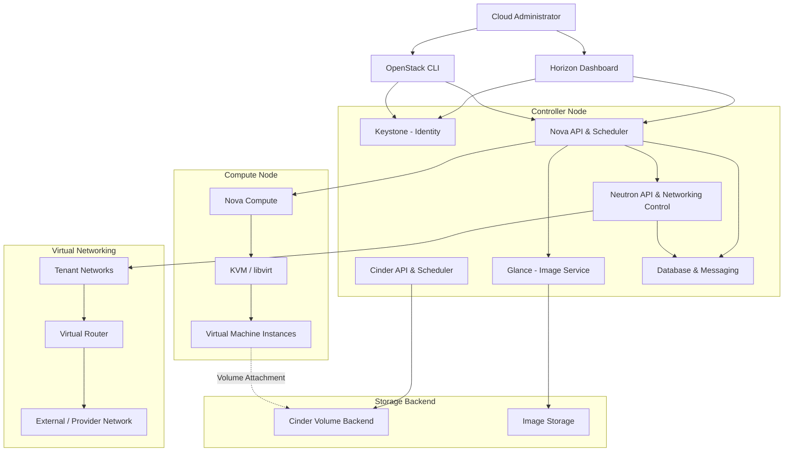

# OpenStack Private Cloud Architecture

## 1. Architecture Overview

This document describes a proposed OpenStack private cloud lab architecture.

The design follows common OpenStack concepts and separates control-plane services, compute workloads, and network connectivity.

**Implementation status:** Proposed architecture only. Deployment and validation are pending.

## 2. Logical Architecture

The diagram is a conceptual representation rather than an exact deployment topology.

Additional agents and services may be required depending on the selected OpenStack release, networking backend, and deployment method.

## 3. Core Infrastructure Components

### Controller Node

The controller node coordinates cloud management operations.

Typical services include:

- Keystone identity services
- Nova API and scheduling services
- Neutron API and control services
- Glance image management
- Cinder API and scheduling services
- Horizon dashboard
- Database and message broker

A production deployment may distribute these services across multiple controllers for high availability.

### Compute Node

The compute node hosts virtual machine workloads.

Typical components include:

- Nova Compute
- KVM hypervisor
- libvirt
- Virtual networking integration

The compute node communicates with controller services to receive scheduling and management instructions.

### Storage Backend

OpenStack supports multiple storage backends.

This proposed lab will explore:

- Glance image storage
- Cinder block volumes
- Volume attachment to instances
- Persistent storage concepts

The specific storage backend will be selected during lab setup.

## 4. Network Architecture

The lab design distinguishes three logical network functions.

| Network | Purpose |
|---|---|
| Management | Communication between OpenStack services and nodes |
| Tenant | Virtual machine workload connectivity |
| External / Provider | Connectivity outside tenant networks |

These are logical functions; they do not necessarily require three separate physical network interfaces.

### Example Address Plan

The following addresses are documentation-only examples.

| Segment | Example subnet |
|---|---|
| Management | 192.0.2.0/24 |
| Tenant Network | 198.51.100.0/24 |
| External Network | 203.0.113.0/24 |

These TEST-NET ranges are not intended for a real internet-connected deployment.

The lab will use suitable private addresses and an explicitly configured external connectivity model.

## 5. OpenStack Service Responsibilities

| Service | Responsibility |
|---|---|
| Keystone | Identity, authentication, and authorization |
| Nova | Compute instance lifecycle |
| Neutron | Virtual networking and connectivity |
| Glance | Image catalog and image management |
| Cinder | Block storage management |
| Horizon | Web-based cloud administration |

## 6. Example Instance Provisioning Workflow

1. An administrator authenticates through Keystone.
2. A compute instance is requested using Horizon or the CLI.
3. Nova validates the request and schedules the instance.
4. Glance provides access to the selected image.
5. Neutron provides network connectivity and port allocation.
6. The compute node launches the instance through its virtualization stack.
7. The instance becomes available for connectivity and operational checks.

This is a simplified workflow; actual provisioning involves additional service interactions.

## 7. Availability and Scaling

The initial lab will prioritize understanding and reproducibility over high availability.

Future enhancements may include:

- Multiple compute nodes
- Controller high availability
- Additional network segments
- Storage redundancy
- Monitoring and alerting
- Automated provisioning

## 8. Security Considerations

- Use role-based access through Keystone.
- Limit management network access.
- Apply Neutron security groups.
- Avoid embedding credentials in scripts.
- Protect administrative API endpoints.
- Use TLS for service endpoints where supported.
- Document and review external network access.

## 9. Proposed Validation Plan

- [ ] Select an OpenStack release and deployment method
- [ ] Define the final network addressing scheme
- [ ] Prepare controller and compute resources
- [ ] Install and configure OpenStack services
- [ ] Validate Keystone authentication
- [ ] Upload a test image to Glance
- [ ] Configure tenant networking
- [ ] Launch a test instance
- [ ] Verify instance network connectivity
- [ ] Attach and verify a Cinder volume
- [ ] Capture execution logs and screenshots

## 10. Current Status

This document presents a proposed technical architecture.

No end-to-end OpenStack deployment has yet been validated as part of this public portfolio repository.

The architecture and configuration details will be updated based on actual lab results.
