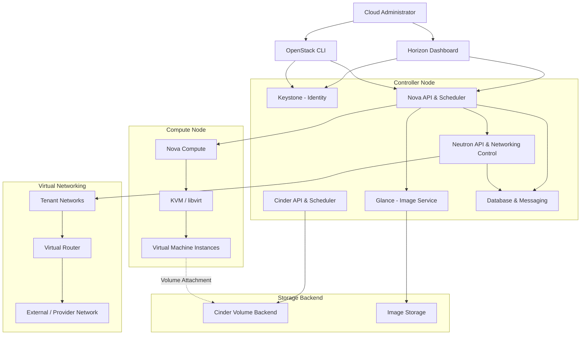

# OpenStack Private Cloud Architecture

## 1. Architecture Overview

This document describes a reference architecture for an OpenStack private cloud environment.

The architecture follows common OpenStack concepts and separates control-plane services, compute workloads, storage resources, and network connectivity.

The design illustrates service responsibilities, infrastructure components, and the interactions required to provision and manage cloud resources.

## 2. Logical Architecture

The diagram provides a conceptual representation of OpenStack service relationships.

Actual deployments may include additional services, agents, and infrastructure components depending on the OpenStack release, networking backend, and deployment method.

## 3. Core Infrastructure Components

### Controller Node

The controller node coordinates cloud management operations and hosts core control-plane services.

Typical services include:

- Keystone identity services
- Nova API and scheduling services
- Neutron API and networking control services
- Glance image management
- Cinder API and scheduling services
- Horizon dashboard
- Database and message broker

In high-availability environments, control-plane services can be distributed across multiple controller nodes.

### Compute Node

Compute nodes provide the virtualization resources used to run cloud instances.

Typical components include:

- Nova Compute
- KVM hypervisor
- libvirt
- Virtual networking integration

Nova Compute communicates with control-plane services to manage instance provisioning, lifecycle operations, and resource allocation.

### Storage Backend

OpenStack supports several storage architectures and backend technologies.

The reference architecture includes:

- Glance image storage
- Cinder block volumes
- Volume attachment to instances
- Persistent storage management

Glance provides image management capabilities, while Cinder manages block storage resources.

Storage backends can include local storage, LVM, Ceph, or compatible enterprise storage systems, depending on the service and deployment design.

## 4. Network Architecture

The architecture distinguishes three logical network functions.

| Network | Purpose |
|---|---|
| Management | Communication between OpenStack services and infrastructure nodes |
| Tenant | Virtual machine workload connectivity |
| External / Provider | Connectivity between cloud resources and external networks |

These logical networks do not necessarily require dedicated physical network interfaces.

Network isolation can be implemented through appropriate physical and virtual networking configurations.

### Example Address Plan

The following addresses are documentation-only examples.

| Segment | Example Subnet |
|---|---|
| Management | 192.0.2.0/24 |
| Tenant Network | 198.51.100.0/24 |
| External Network | 203.0.113.0/24 |

These TEST-NET ranges are reserved for documentation and should be replaced with suitable addressing in an actual deployment.

### Network Connectivity

A typical private cloud network topology includes:

- Management connectivity between nodes
- Private tenant networks
- Virtual routers for Layer 3 connectivity
- Security groups for traffic filtering
- Provider networks for external access
- Floating IP addresses for selected instances

Neutron coordinates these networking resources through the configured networking backend.

## 5. OpenStack Service Responsibilities

| Service | Responsibility |
|---|---|
| Keystone | Identity, authentication, and authorization |
| Nova | Compute instance lifecycle management |
| Neutron | Virtual networking, routing, and connectivity |
| Glance | Image catalog and image management |
| Cinder | Persistent block storage management |
| Horizon | Web-based cloud administration |

These services work together to provide an integrated private cloud environment.

## 6. Instance Provisioning Workflow

A typical virtual machine provisioning process includes:

1. An administrator authenticates through Keystone.
2. A compute instance is requested using Horizon or the OpenStack CLI.
3. Nova processes the request and schedules the instance on a suitable compute host.
4. Glance provides access to the selected operating system image.
5. Neutron allocates the required networking resources.
6. The compute node launches the instance through KVM/libvirt.
7. The instance becomes available for connectivity and operational checks.

This workflow is simplified to highlight the main infrastructure components.

Actual instance provisioning includes additional internal service communication and resource allocation operations.

## 7. Availability and Scaling

OpenStack supports different infrastructure deployment models, from compact development environments to distributed cloud platforms.

Scalability and availability considerations include:

- Multiple compute nodes
- Controller high availability
- Distributed networking components
- Storage redundancy
- Monitoring and alerting
- Automated provisioning
- Capacity management

The architecture can be extended according to workload requirements, infrastructure resources, and availability objectives.

## 8. Security Considerations

Security controls should be implemented across identity, networking, compute, and storage components.

Key considerations include:

- Use role-based access control through Keystone.
- Restrict management network access.
- Apply Neutron security groups.
- Separate administrative and ordinary user permissions.
- Avoid embedding credentials in scripts.
- Protect API endpoints using TLS.
- Review external network connectivity.
- Monitor authentication and administrative activities.
- Protect storage backends and sensitive data.
- Maintain appropriate logging and audit procedures.

## 9. Architecture Verification Checklist

### Control Plane

- [ ] Verify Keystone authentication
- [ ] Verify Nova API availability
- [ ] Verify Neutron API availability
- [ ] Verify Glance image service
- [ ] Verify Cinder block storage service
- [ ] Verify Horizon dashboard access

### Compute

- [ ] Verify compute node availability
- [ ] Inspect hypervisor resources
- [ ] Confirm image and flavor availability
- [ ] Provision a virtual machine instance
- [ ] Verify instance lifecycle operations

### Networking

- [ ] Verify tenant network configuration
- [ ] Verify subnet and gateway settings
- [ ] Verify router connectivity
- [ ] Inspect security group rules
- [ ] Validate floating IP connectivity
- [ ] Verify instance network communication

### Storage

- [ ] Verify image storage availability
- [ ] Verify Cinder storage backend
- [ ] Create a block storage volume
- [ ] Attach the volume to an instance
- [ ] Verify persistent storage access

### Operations

- [ ] Review service logs
- [ ] Verify service health
- [ ] Inspect infrastructure resource utilization
- [ ] Document troubleshooting procedures
- [ ] Record configuration and verification results

## 10. Related Documentation

- [Keystone Identity Management](keystone-identity.md)
- [Nova Compute Management](nova-compute.md)
- [Neutron Networking](neutron-networking.md)
- [Glance Image Management](glance-images.md)
- [Cinder Block Storage](cinder-storage.md)
- [Operations and Troubleshooting](troubleshooting.md)

## 11. References

- [OpenStack Documentation](https://docs.openstack.org/)
- [OpenStack Architecture Design Guide](https://docs.openstack.org/arch-design/)
- [OpenStack Operations Guide](https://docs.openstack.org/operations-guide/)
