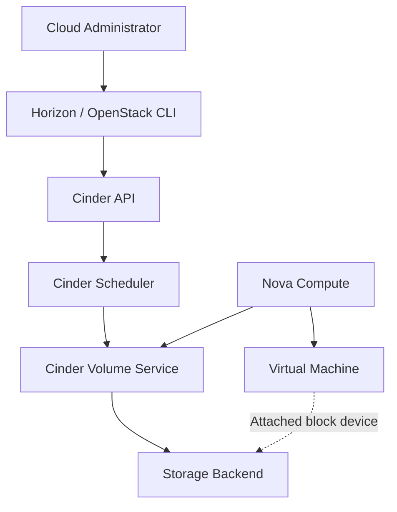

# OpenStack Cinder — Block Storage Management

## 1. Overview

Cinder is the OpenStack Block Storage service. It provisions persistent block storage volumes that can be attached to virtual machine instances.

Unlike instance ephemeral storage, Cinder volumes can normally remain available after an instance is deleted, depending on the volume's lifecycle settings and cloud policies.

This document describes a proposed block storage lab covering volume creation, attachment, snapshots, capacity expansion, and troubleshooting.

**Status:** Configuration examples prepared. Lab validation pending.

## 2. Cinder Architecture



This diagram is conceptual. The actual data path and attachment mechanism depend on the selected Cinder storage driver and backend.

## 3. Core Components

| Component | Responsibility |
|---|---|
| Cinder API | Handles block storage API requests |
| Cinder Scheduler | Selects a suitable storage backend |
| Cinder Volume | Manages volume lifecycle and backend operations |
| Storage Backend | Stores block volume data |
| Volume Type | Defines storage characteristics and backend selection |
| Nova Compute | Coordinates volume attachment to instances |

Possible storage backends include LVM, Ceph RBD, and supported storage arrays.

The final lab backend will be selected during deployment.

## 4. Proposed Lab Scenario

| Resource | Example |
|---|---|
| Project | infrastructure-lab |
| Instance | lab-vm01 |
| Volume | lab-data-volume |
| Initial Size | 10 GiB |
| Expanded Size | 20 GiB |
| Snapshot | lab-data-snapshot |
| Volume Purpose | Persistent application data |

The volume is a separate block device, not the instance's root disk.

## 5. Prerequisites

Before beginning:

- Authenticate to a working OpenStack deployment.
- Verify that Cinder is available.
- Confirm that a storage backend is configured.
- Confirm sufficient storage quota and capacity.
- Prepare the VM `lab-vm01`.
- Ensure the selected volume type is accessible.

Check authentication:

```bash
openstack token issue
```

List volumes:

```bash
openstack volume list
```

List available volume types:

```bash
openstack volume type list
```

Administrators can inspect Cinder services:

```bash
openstack volume service list
```

## 6. Create a Volume

Create a 10 GiB volume:

```bash
openstack volume create \
  --size 10 \
  --description "Persistent storage for lab-vm01" \
  lab-data-volume
```

Verify its status:

```bash
openstack volume show lab-data-volume
```

Expected status before attachment:

`available`

A different status may indicate that provisioning is still in progress or has failed.

## 7. Attach Volume to an Instance

Attach the volume to `lab-vm01`:

```bash
openstack server add volume \
  lab-vm01 lab-data-volume
```

Verify the attachment:

```bash
openstack volume show lab-data-volume
openstack server volume list lab-vm01
```

Expected attached-volume status:

`in-use`

The guest operating system must still detect and prepare the new block device.

## 8. Configure Storage Inside Linux

Connect to the test VM and identify the disk:

```bash
lsblk -f
```

For a newly created, empty data volume, the lab may create a filesystem.

**Warning:** The following operations are destructive if executed against the wrong device.

Verify the device name and confirm that the disk contains no data before proceeding.

Example only, assuming the attached disk appears as `/dev/vdb`:

```bash
sudo mkfs.ext4 /dev/vdb
```

Create a mount point:

```bash
sudo mkdir -p /mnt/lab-data
```

Mount the volume:

```bash
sudo mount /dev/vdb /mnt/lab-data
```

Verify:

```bash
df -h /mnt/lab-data
lsblk -f
```

Device naming varies by hypervisor, interface, and guest operating system.

For persistent mounting, use the filesystem UUID in `/etc/fstab` rather than relying on a potentially changing device name.

## 9. Create a Test File

Inside the guest:

```bash
echo "OpenStack Cinder persistent storage test" \
  | sudo tee /mnt/lab-data/test.txt
```

Verify the file:

```bash
cat /mnt/lab-data/test.txt
```

This provides a simple reference point for later persistence checks.

## 10. Create a Volume Snapshot

Snapshots capture a point-in-time state of a volume.

For a consistent lab snapshot, stop writes and detach the volume before creating a snapshot.

For a detached volume:

```bash
openstack volume snapshot create \
  --volume lab-data-volume \
  lab-data-snapshot
```

List snapshots:

```bash
openstack volume snapshot list
```

Inspect the snapshot:

```bash
openstack volume snapshot show lab-data-snapshot
```

Depending on the storage driver and API permissions, snapshots of attached volumes may require additional options or backend capabilities.

A snapshot is not a substitute for an independent, tested backup.

## 11. Restore Data Using a Snapshot

Create a new volume from the snapshot:

```bash
openstack volume create \
  --snapshot lab-data-snapshot \
  --size 10 \
  lab-restored-volume
```

Verify:

```bash
openstack volume show lab-restored-volume
```

The resulting volume can be attached to a suitable test instance to verify data recovery.

Do not overwrite an existing volume during recovery testing.

## 12. Expand Volume Capacity

Volume expansion is a two-part process:

1. Increase the size of the Cinder volume.
2. Expand the partition or filesystem inside the guest.

For a detached volume that is in the `available` state:

```bash
openstack volume set \
  --size 20 \
  lab-data-volume
```

Verify:

```bash
openstack volume show lab-data-volume
```

After reattaching the volume, inspect the block device:

```bash
lsblk
```

If the ext4 filesystem was created directly on the block device and the device is `/dev/vdb`, an example guest-side expansion is:

```bash
sudo resize2fs /dev/vdb
```

Verify:

```bash
df -h /mnt/lab-data
```

If the volume uses partitions, LVM, XFS, or another layout, different expansion procedures are required.

Online expansion support also depends on the selected Cinder backend, guest operating system, and cloud configuration.

## 13. Detach a Volume

Before detaching, stop application writes and unmount the filesystem inside the guest:

```bash
sudo umount /mnt/lab-data
```

Then detach it through OpenStack:

```bash
openstack server remove volume \
  lab-vm01 lab-data-volume
```

Check the volume status:

```bash
openstack volume show lab-data-volume
```

The volume should return to `available` when detachment completes.

Never detach a device that contains an active mounted filesystem without a safe shutdown or unmount procedure.

## 14. Delete a Volume

Confirm the volume is detached and contains no required data.

Then delete it:

```bash
openstack volume delete lab-data-volume
```

Deletion is destructive.

Snapshots, dependencies, policies, or backend conditions may prevent volume deletion.

## 15. Troubleshooting

### Volume Remains in Creating State

Check:

- Cinder Volume service status
- Available storage capacity
- Storage backend connectivity
- Storage quotas
- Scheduler placement
- Relevant Cinder service logs

Commands:

```bash
openstack volume show lab-data-volume
openstack volume service list
```

### Volume Attachment Fails

Check:

- VM state
- Volume state
- Compute host connectivity
- Cinder backend accessibility
- Volume attachment limits
- Nova and Cinder logs

Commands:

```bash
openstack server show lab-vm01
openstack volume show lab-data-volume
openstack server volume list lab-vm01
```

### Guest Cannot See the Disk

Inside the VM:

```bash
lsblk
sudo dmesg | tail -n 30
```

Check the attachment state in OpenStack before modifying guest storage.

### Filesystem Reports Insufficient Space

Check:

- Cloud-side volume size
- Guest-visible block device size
- Partition size, if applicable
- Filesystem size
- Mounted device

Commands:

```bash
lsblk
df -h
```

Expanding the cloud volume does not automatically guarantee that the guest filesystem has expanded.

## 16. Operational Best Practices

- Use consistent volume naming conventions.
- Separate application data from ephemeral instance storage.
- Monitor volume capacity and performance.
- Review storage quotas.
- Test backup and restore procedures.
- Document volume ownership and dependencies.
- Restrict administrative permissions.
- Verify snapshots for application consistency.
- Avoid committing credentials or internal storage details.

## 17. Lab Validation Checklist

- [ ] Verify Cinder API and services
- [ ] Confirm a working storage backend
- [ ] Create a 10 GiB data volume
- [ ] Attach the volume to lab-vm01
- [ ] Detect the disk inside Linux
- [ ] Create and mount a filesystem
- [ ] Write and verify test data
- [ ] Safely detach the volume
- [ ] Create a snapshot
- [ ] Restore a new volume from the snapshot
- [ ] Verify restored test data
- [ ] Expand a volume from 10 GiB to 20 GiB
- [ ] Verify filesystem expansion
- [ ] Document sanitized command outputs and screenshots

## 18. Current Status

The procedures above are configuration examples for a proposed OpenStack private cloud lab.

They have not been executed or validated in the public portfolio environment.

Actual test results, backend-specific procedures, and troubleshooting evidence will be added after lab deployment.

## References

- [OpenStack Cinder Documentation](https://docs.openstack.org/cinder/latest/)
- [OpenStackClient Block Storage Commands](https://docs.openstack.org/python-openstackclient/latest/cli/command-objects/volume/v3/index.html)
- [OpenStackClient Compute Commands](https://docs.openstack.org/python-openstackclient/latest/cli/command-objects/compute/v2/index.html)
