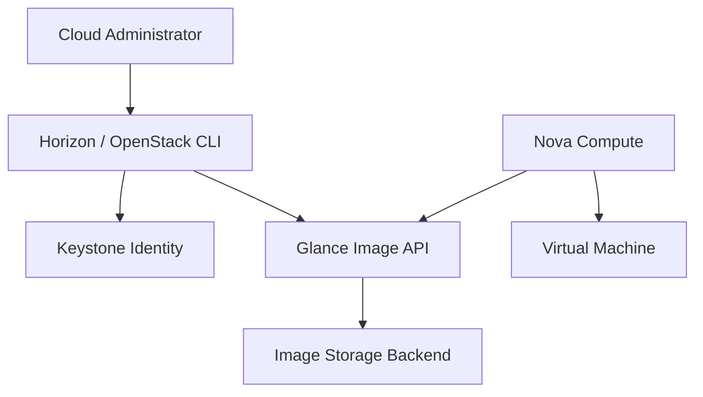

# OpenStack Glance — Image Management

## 1. Overview

Glance is the OpenStack Image service. It manages virtual machine images and makes them available to other OpenStack services, including Nova.

Images contain the operating system and supporting configuration needed to boot virtual machines.

This document describes image management, image formats, upload procedures, verification, and troubleshooting for a proposed private cloud lab.

**Status:** Documentation and CLI examples prepared. Lab validation pending.

## 2. Glance Architecture



This is a simplified logical architecture. Actual image retrieval and caching depend on the deployment configuration.

## 3. Core Concepts

| Concept | Description |
|---|---|
| Image | Bootable virtual machine disk image |
| Image ID | Unique identifier assigned by Glance |
| Disk Format | Format of the virtual disk data |
| Container Format | Packaging information for the image |
| Visibility | Controls which projects can discover an image |
| Image Status | Indicates the image lifecycle state |
| Storage Backend | Stores image data |

## 4. Common Image Formats

### QCOW2

QCOW2 is a QEMU disk image format commonly used with KVM-based virtualization.

### RAW

RAW images represent unstructured virtual disk data and are supported by many virtualization platforms.

### Container Format

The `bare` container format is commonly used for standard virtual machine disk images.

Supported formats and operational restrictions depend on the configured cloud.

## 5. Proposed Lab Scenario

The lab will use an official Linux cloud image to provision virtual machines.

| Resource | Example |
|---|---|
| Image Name | ubuntu-lab-image |
| Disk Format | qcow2 |
| Container Format | bare |
| Visibility | private |
| Target Instance | lab-vm01 |
| Compute Service | Nova |

The actual operating system version and image source will be selected during lab setup.

## 6. Prerequisites

Before uploading an image:

- Authenticate to a working OpenStack cloud.
- Verify Glance service availability.
- Download an image from an official, trusted source.
- Confirm that the image format is supported.
- Verify available image storage and quotas.
- Confirm permission to upload images.

Verify authentication:

```bash
openstack token issue
```

List available images:

```bash
openstack image list
```

Inspect the Image service endpoint:

```bash
openstack endpoint list --service image
```

## 7. Image Download and Verification

Download a suitable Linux cloud image from the operating system's official distribution site.

Save it locally as:

`ubuntu-lab.qcow2`

The filename is illustrative; do not assume that a downloaded file is QCOW2 merely because of its extension.

Inspect the downloaded image:

```bash
qemu-img info ubuntu-lab.qcow2
```

Verify the file checksum against the checksum published by the trusted source.

Example:

```bash
sha256sum ubuntu-lab.qcow2
```

Do not upload an image with an unverified origin or unknown contents.

## 8. Upload an Image

Upload a private QCOW2 image:

```bash
openstack image create ubuntu-lab-image \
  --file ubuntu-lab.qcow2 \
  --disk-format qcow2 \
  --container-format bare \
  --private
```

The specified disk format must match the actual image data.

Confirm creation:

```bash
openstack image show ubuntu-lab-image
```

## 9. Verify Image Status

List images:

```bash
openstack image list
```

Inspect image properties:

```bash
openstack image show ubuntu-lab-image
```

Check the status:

```bash
openstack image show ubuntu-lab-image \
  -c status \
  -c disk_format \
  -c container_format \
  -c size
```

An image generally needs to reach the `active` state before it can be used to create a virtual machine.

## 10. Image Visibility

Common visibility options include:

- private
- shared
- community
- public

Availability and permission to change visibility depend on the deployed Glance policies.

The lab uses a private image to limit access to the intended project.

Inspect visibility:

```bash
openstack image show ubuntu-lab-image \
  -c visibility
```

## 11. Image Properties

Additional image metadata can describe operating system information and virtualization requirements.

Example:

```bash
openstack image set \
  --property os_distro=ubuntu \
  ubuntu-lab-image
```

Inspect the updated metadata:

```bash
openstack image show ubuntu-lab-image
```

Metadata values should accurately represent the image.

## 12. Launch an Instance Using the Image

After configuring Nova, Neutron, and the required resources, provision a test instance:

```bash
openstack server create \
  --image ubuntu-lab-image \
  --flavor lab.small \
  --network private-lab-net \
  --security-group lab-ssh \
  --key-name lab-key \
  lab-vm01
```

Verify:

```bash
openstack server show lab-vm01
```

The flavor, network, security group, and key pair must already exist.

Successful instance provisioning also depends on image compatibility with the hypervisor and resource allocation.

## 13. Save an Existing Image

If permitted, download an existing image:

```bash
openstack image save \
  --file downloaded-image.qcow2 \
  ubuntu-lab-image
```

Confirm the image's actual disk format before choosing the output filename or using the downloaded file.

Avoid distributing images that contain credentials, private information, or proprietary software without authorization.

## 14. Delete an Image

Delete a lab image only after confirming that it is no longer required:

```bash
openstack image delete ubuntu-lab-image
```

Deletion removes the image from the cloud image service and may affect future instance provisioning or rebuild operations.

## 15. Troubleshooting

### Image Upload Fails

Check:

- Authentication and authorization
- Image service availability
- Storage capacity and image quotas
- Upload limits
- Image file integrity
- Supported disk format

Useful commands:

```bash
openstack token issue
openstack image list
openstack endpoint list --service image
```

### Image Is Not Active

Inspect:

```bash
openstack image show ubuntu-lab-image
```

Check Glance service logs where administrative access is available.

A failed upload, unavailable storage backend, or image validation error may prevent activation.

### Instance Cannot Boot from Image

Check:

- Image status and format
- Image architecture
- Hypervisor compatibility
- Flavor disk and memory settings
- Boot configuration
- Nova and compute service logs

Useful commands:

```bash
openstack image show ubuntu-lab-image
openstack flavor show lab.small
openstack server show lab-vm01
```

### Image Is Not Visible to a User

Check:

- Image visibility
- Project membership
- Keystone role assignments
- Image sharing configuration
- Glance policies

## 16. Security Considerations

- Use official and trusted image sources.
- Validate checksums before upload.
- Apply required operating system updates.
- Remove embedded passwords and private keys.
- Avoid storing production data in reusable images.
- Restrict image visibility appropriately.
- Use image metadata and versioning consistently.
- Follow organizational image retention policies.

## 17. Lab Validation Checklist

- [ ] Verify Glance API availability
- [ ] Obtain a trusted Linux cloud image
- [ ] Verify checksum and disk format
- [ ] Upload the image to Glance
- [ ] Verify image status is active
- [ ] Inspect image metadata
- [ ] Verify image visibility
- [ ] Launch a test VM using Nova
- [ ] Verify the guest operating system boots
- [ ] Capture sanitized execution logs
- [ ] Document troubleshooting results

## 18. Current Status

The image management workflow and CLI commands in this document are prepared for an isolated OpenStack lab.

The commands have not yet been executed or validated as part of this public portfolio repository.

Actual deployment evidence will be added after testing.

## References

- [OpenStackClient Image Commands](https://docs.openstack.org/python-openstackclient/latest/cli/command-objects/image/v2/index.html)
- [Glance Image Service Documentation](https://docs.openstack.org/glance/latest/)
- [OpenStack Image Service API](https://docs.openstack.org/api-ref/image/v2/)
