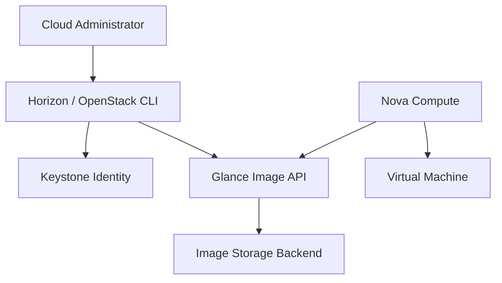

# OpenStack Glance — Image Management

## 1. Overview

Glance is the OpenStack Image service responsible for storing, discovering, and managing virtual machine images.

It provides an image catalog that other OpenStack services, including Nova, can use for virtual machine provisioning.

This document covers Glance architecture, image formats, upload procedures, image management, security, and troubleshooting.

## 2. Glance Architecture



The diagram illustrates the logical relationship between image administration, image storage, and instance provisioning.

Image retrieval, caching, and storage access depend on the OpenStack deployment configuration.

## 3. Core Concepts

| Component | Description |
|---|---|
| Image | Virtual disk image used for instance provisioning |
| Image ID | Unique identifier assigned by Glance |
| Disk Format | Format of the stored virtual disk |
| Container Format | Packaging information for the image |
| Visibility | Controls image discovery and access |
| Image Status | Indicates image lifecycle state |
| Storage Backend | Provides storage for image data |

## 4. Image Formats

### QCOW2

QCOW2 is a QEMU disk image format commonly used with KVM virtualization.

It supports features such as copy-on-write and dynamically allocated storage.

### RAW

RAW images contain unstructured virtual disk data and are supported by multiple virtualization technologies.

### Container Format

The `bare` container format is commonly used for standard virtual machine images.

Supported formats and operational restrictions depend on the cloud configuration.

## 5. Image Administration Scenario

The example uses a Linux cloud image for virtual machine provisioning.

| Resource | Example |
|---|---|
| Image Name | ubuntu-lab-image |
| Disk Format | qcow2 |
| Container Format | bare |
| Visibility | private |
| Target Instance | lab-vm01 |
| Compute Service | Nova |

These resource names are illustrative and should correspond to the actual cloud configuration when commands are executed.

## 6. Prerequisites

Image administration requires:

- Access to the OpenStack Image service
- OpenStackClient installed
- Valid authentication credentials
- Appropriate permissions for image management
- Sufficient image storage and quota
- A compatible virtual disk image

Verify authentication:

```bash
openstack token issue
```

List images:

```bash
openstack image list
```

Inspect Image service endpoints:

```bash
openstack endpoint list --service image
```

## 7. Image Download and Verification

Obtain a Linux cloud image from an official, trusted distribution source.

For the example below, save a compatible QCOW2 image as:

`ubuntu-lab.qcow2`

Inspect its actual format:

```bash
qemu-img info ubuntu-lab.qcow2
```

Calculate its checksum:

```bash
sha256sum ubuntu-lab.qcow2
```

Compare the checksum with the checksum published by the trusted image provider.

A filename extension alone does not verify the actual image format or integrity.

## 8. Upload an Image

Create a private image:

```bash
openstack image create ubuntu-lab-image \
  --file ubuntu-lab.qcow2 \
  --disk-format qcow2 \
  --container-format bare \
  --private
```

The selected disk format must match the image data.

Verify creation:

```bash
openstack image show ubuntu-lab-image
```

## 9. Image Status and Inspection

List available images:

```bash
openstack image list
```

Inspect image details:

```bash
openstack image show ubuntu-lab-image
```

Display selected properties:

```bash
openstack image show ubuntu-lab-image \
  -c status \
  -c disk_format \
  -c container_format \
  -c size
```

An image generally must reach the `active` status before it can be used to create a virtual machine.

## 10. Image Visibility

Common visibility settings include:

- private
- shared
- community
- public

Image visibility determines discovery and access behavior according to Glance policies and project permissions.

Private images are associated with the owning project.

Inspect the visibility setting:

```bash
openstack image show ubuntu-lab-image \
  -c visibility
```

Image sharing and public visibility changes may require additional permissions.

## 11. Image Metadata

Glance supports image properties that describe operating system information and other attributes.

Example:

```bash
openstack image set \
  --property os_distro=ubuntu \
  ubuntu-lab-image
```

Inspect metadata:

```bash
openstack image show ubuntu-lab-image
```

Image metadata should accurately represent the operating system and technical requirements of the image.

## 12. Instance Provisioning with Glance

Nova uses Glance images during instance provisioning.

Example:

```bash
openstack server create \
  --image ubuntu-lab-image \
  --flavor lab.small \
  --network private-lab-net \
  --security-group lab-ssh \
  --key-name lab-key \
  lab-vm01
```

Verify the instance:

```bash
openstack server show lab-vm01
```

The selected flavor, network, security group, and key pair must exist.

Image architecture and virtual hardware requirements must also be compatible with the available compute resources.

## 13. Download an Existing Image

Download an image when authorized:

```bash
openstack image save \
  --file downloaded-image.qcow2 \
  ubuntu-lab-image
```

Verify the image format after downloading.

The output filename should correspond to the actual disk format.

Avoid distributing images containing credentials, proprietary software, or sensitive information without authorization.

## 14. Image Deletion

Delete an image:

```bash
openstack image delete ubuntu-lab-image
```

Image deletion is destructive and can prevent future instance creation or rebuild operations that depend on the image.

Review image ownership, dependencies, and retention requirements before deletion.

## 15. Troubleshooting

### Image Upload Failure

Possible causes:

- Authentication or authorization failure
- Glance API unavailability
- Insufficient storage capacity
- Image quota restrictions
- Unsupported disk format
- Upload limits
- Corrupted image files

Commands:

```bash
openstack token issue
openstack image list
openstack endpoint list --service image
```

Review service logs and storage backend availability where authorized.

### Image Does Not Reach ACTIVE

Inspect the image:

```bash
openstack image show ubuntu-lab-image
```

Review:

- Image status
- Storage backend connectivity
- Available storage capacity
- Image validation errors
- Glance service logs

### Instance Cannot Boot from Image

Check:

- Image format and status
- Operating system architecture
- Hypervisor compatibility
- Flavor resources
- Boot configuration
- Nova instance events
- Compute service logs

Commands:

```bash
openstack image show ubuntu-lab-image
openstack flavor show lab.small
openstack server show lab-vm01
```

### Image Not Visible to a User

Verify:

- Image visibility
- Owning project
- Project access
- Keystone role assignments
- Image sharing configuration
- Glance policies

Use an authenticated session with appropriate permissions to inspect the image.

## 16. Security Considerations

- Download images from trusted sources.
- Verify checksums and image integrity.
- Use supported operating system versions.
- Apply security updates to base images.
- Remove embedded passwords and private keys.
- Avoid including confidential data in reusable images.
- Restrict visibility appropriately.
- Review image permissions.
- Maintain consistent image naming and metadata.
- Follow image retention policies.

## 17. Operational Verification Checklist

### Image Service

- [ ] Verify Glance API access
- [ ] Inspect available images
- [ ] Verify Image service endpoints
- [ ] Inspect storage backend availability

### Image Management

- [ ] Obtain a trusted Linux cloud image
- [ ] Verify checksum and disk format
- [ ] Upload an image
- [ ] Verify image status
- [ ] Inspect image metadata
- [ ] Confirm image visibility

### Compute Integration

- [ ] Select a compatible flavor
- [ ] Provision an instance using the image
- [ ] Verify operating system startup
- [ ] Inspect instance status and events

### Troubleshooting

- [ ] Investigate an image upload failure
- [ ] Review image storage availability
- [ ] Investigate an image compatibility issue
- [ ] Document diagnostic findings and corrective actions

## 18. Related Documentation

- [OpenStack Architecture](architecture.md)
- [Nova Compute Management](nova-compute.md)
- [Keystone Identity Management](keystone-identity.md)
- [Operations and Troubleshooting](troubleshooting.md)

## 19. References

- [OpenStack Glance Documentation](https://docs.openstack.org/glance/latest/)
- [OpenStackClient Image Commands](https://docs.openstack.org/python-openstackclient/latest/cli/command-objects/image/v2/index.html)
- [OpenStack Image Service API](https://docs.openstack.org/api-ref/image/v2/)
