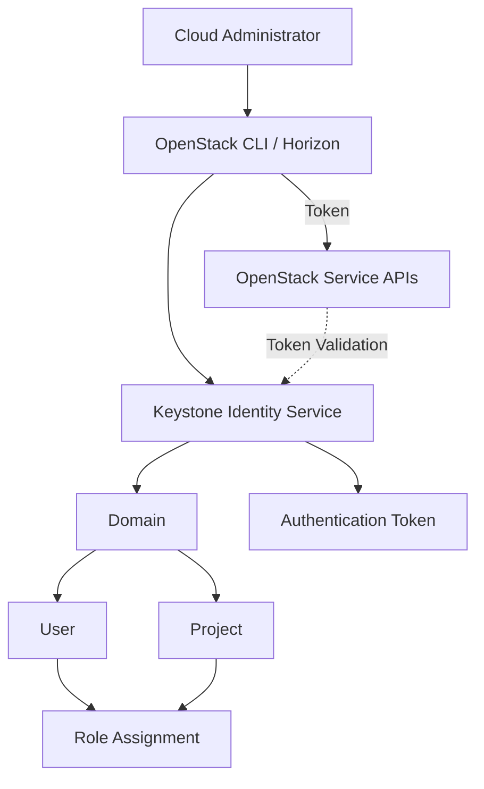

# OpenStack Keystone — Identity Management

## 1. Overview

Keystone is the OpenStack Identity service responsible for authentication, authorization, and service catalog management.

It provides centralized identity and access management for users, projects, and OpenStack services.

This document covers Keystone architecture, identity administration, role-based access control, authentication workflows, security, and troubleshooting.

## 2. Keystone Responsibilities

Core capabilities include:

- User authentication
- Domain and project management
- Role-based access control (RBAC)
- Token-based authentication
- Service catalog and endpoint management
- Identity federation and external identity integration

## 3. Identity Management Architecture



The diagram illustrates the relationship between identity resources, authentication tokens, and OpenStack services.

Actual authorization decisions depend on service-specific policies and token scope.

## 4. Identity Management Scenario

A dedicated OpenStack project provides logical separation for infrastructure resources and access permissions.

### Example Identity Resources

| Object | Example |
|---|---|
| Domain | Default |
| Project | infrastructure-lab |
| User | lab-operator |
| Role | member |
| Access Scope | Project |
| Purpose | Manage resources within the assigned project |

The `member` role provides project-scoped permissions according to the active service policies.

It does not automatically grant unrestricted cloud administration privileges.

## 5. Prerequisites

Keystone administration requires:

- An accessible OpenStack environment
- OpenStackClient installed
- Valid authentication credentials
- Appropriate identity management permissions
- Correct domain and project configuration

Verify authentication:

```bash
openstack token issue
```

List configured identity endpoints:

```bash
openstack endpoint list --service identity
```

Authentication credentials and administrative RC files must be protected.

## 6. Project Management

### Create a Project

```bash
openstack project create \
  --domain default \
  --description "Private Cloud Infrastructure Lab" \
  infrastructure-lab
```

### Verify the Project

```bash
openstack project show infrastructure-lab
```

### List Projects

```bash
openstack project list
```

Projects provide a scope for resource ownership, quotas, and access control.

## 7. User Management

### Create a User

```bash
openstack user create \
  --domain default \
  --password-prompt \
  lab-operator
```

The interactive password prompt avoids exposing the password directly in the command line.

### Verify the User

```bash
openstack user show lab-operator
```

### List Users

```bash
openstack user list
```

User accounts should be managed according to organizational identity and access management policies.

## 8. Role-Based Access Control

Keystone uses role assignments to associate users or groups with permissions within a specific scope.

### List Available Roles

```bash
openstack role list
```

### Assign a Project Role

```bash
openstack role add \
  --project infrastructure-lab \
  --user lab-operator \
  member
```

The example assumes a role named `member` exists.

### Verify Role Assignment

```bash
openstack role assignment list \
  --project infrastructure-lab \
  --user lab-operator \
  --names
```

### Remove a Role Assignment

```bash
openstack role remove \
  --project infrastructure-lab \
  --user lab-operator \
  member
```

Role removal changes the user's access to project resources and should be performed only as an authorized administrative operation.

## 9. Authentication Workflow

A typical project-scoped authentication process includes:

1. A client sends an authentication request to Keystone.
2. Keystone validates the supplied identity credentials.
3. Keystone evaluates the requested project scope.
4. Keystone issues an authentication token.
5. The client submits the token when accessing an OpenStack API.
6. The target service validates the token and applies its authorization policies.

### Authentication vs. Authorization

| Authentication | Authorization |
|---|---|
| Confirms identity | Determines permitted actions |
| Uses credentials or other authentication methods | Uses roles, scope, and service policies |
| Managed through Keystone | Enforced by OpenStack services |
| Produces an authenticated context | Controls resource operations |

## 10. Token Management

Inspect authentication information:

```bash
openstack token issue
```

The command can display token-related information, including the token identifier and expiration.

Treat authentication tokens as sensitive credentials.

Avoid copying token output into public logs, documentation, or repositories.

### Token Considerations

- Tokens have a defined validity period.
- Project-scoped tokens are associated with a project context.
- Services validate tokens before authorizing requests.
- Expired or invalid tokens cause authentication failures.
- Token permissions depend on assigned roles and service policies.

## 11. Domain and Project Organization

Keystone domains provide an administrative boundary for identity resources.

Projects organize cloud resources and support project-scoped access control.

A conceptual structure:

```text
Default Domain
│
├── Users
│   ├── cloud-admin
│   └── lab-operator
│
├── Projects
│   └── infrastructure-lab
│
└── Roles
    ├── admin
    ├── member
    └── reader
```

Role availability and default role names may differ between OpenStack deployments.

## 12. Security Best Practices

### Least Privilege

Assign users only the permissions required for their responsibilities.

Avoid unnecessary administrative role assignments.

### Administrative Separation

Separate cloud administrator accounts from ordinary project user accounts.

### Credential Protection

- Do not store plaintext passwords in scripts.
- Protect authentication tokens.
- Avoid committing credentials to source control.
- Use approved secret management solutions.
- Protect administrative RC files.

### Network Security

- Restrict access to identity service endpoints.
- Use TLS for API communication.
- Monitor authentication errors.
- Review administrative activity.

### Access Reviews

Periodically review:

- User accounts
- Project membership
- Role assignments
- Service permissions
- Unused or inactive credentials

## 13. Troubleshooting

### Authentication Failure

**Symptom:** OpenStack CLI cannot authenticate.

Check:

- Keystone API availability
- Authentication endpoint
- Username and domain
- Password validity
- Authentication method
- Project scope

Commands:

```bash
openstack token issue
openstack endpoint list --service identity
```

For additional diagnostic information:

```bash
openstack --debug token issue
```

Debug output may contain sensitive information and must be sanitized before sharing.

### Authorization Failure

**Symptom:** A user authenticates successfully but cannot perform an operation.

Check:

- Role assignments
- Project scope
- Service policy configuration
- Required permissions
- Token scope

Command:

```bash
openstack role assignment list \
  --user lab-operator \
  --names
```

### Project Access Issues

**Symptom:** A user cannot access the expected project.

Verify the project:

```bash
openstack project show infrastructure-lab
```

Verify role assignments:

```bash
openstack role assignment list \
  --project infrastructure-lab \
  --user lab-operator \
  --names
```

Confirm that the user authenticates with the intended project and domain.

### Identity Endpoint Failure

**Symptom:** Authentication requests fail because the identity service is unreachable.

Check:

- DNS resolution
- Network connectivity
- API endpoint configuration
- TLS certificate validity
- Reverse proxy or web server status
- Keystone application logs
- Supporting database availability

The relevant service names and log paths depend on the deployment architecture.

## 14. Operational Verification Checklist

### Identity Service

- [ ] Verify Keystone API reachability
- [ ] Confirm successful authentication
- [ ] Inspect identity endpoints
- [ ] Review identity service logs

### Project and User Management

- [ ] Verify project creation
- [ ] Verify user creation
- [ ] Inspect domain assignments
- [ ] Confirm project visibility

### Authorization

- [ ] Verify available roles
- [ ] Assign a project-scoped role
- [ ] Verify role assignments
- [ ] Confirm expected access permissions
- [ ] Test unauthorized access restrictions

### Security

- [ ] Verify TLS-protected API communication
- [ ] Review administrative role assignments
- [ ] Check credential handling
- [ ] Review authentication failures
- [ ] Document access management procedures

## 15. Related Documentation

- [OpenStack Architecture](architecture.md)
- [Nova Compute Management](nova-compute.md)
- [Neutron Networking](neutron-networking.md)
- [Operations and Troubleshooting](troubleshooting.md)

## 16. References

- [OpenStack Keystone Documentation](https://docs.openstack.org/keystone/latest/)
- [OpenStackClient Identity Commands](https://docs.openstack.org/python-openstackclient/latest/cli/command-objects/identity/v3/index.html)
- [OpenStack Documentation](https://docs.openstack.org/)
