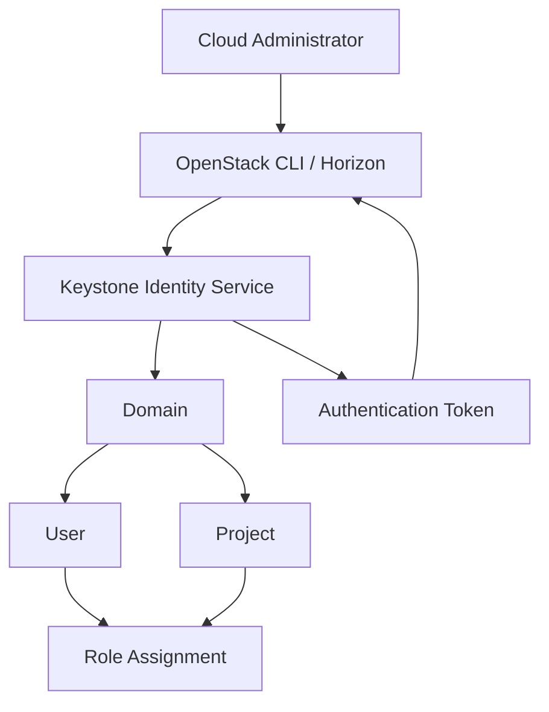

# OpenStack Keystone — Identity Management

## 1. Overview

Keystone is the identity service of OpenStack.

It provides authentication, authorization, and service catalog functionality for an OpenStack cloud.

This document describes common Keystone administration tasks and a proposed identity management scenario for an isolated private cloud lab.

**Status:** Configuration examples prepared. Lab validation pending.

## 2. Keystone Responsibilities

Keystone provides:

- User authentication
- Project and domain management
- Role-based access control (RBAC)
- Token-based authentication
- Service catalog and endpoint management
- Identity integration capabilities

## 3. Identity Management Architecture



The diagram is conceptual and simplifies the Keystone authentication and authorization process.

## 4. Lab Scenario

The proposed lab uses a dedicated project for infrastructure testing.

Example objects:

| Object | Example |
|---|---|
| Domain | Default |
| Project | infrastructure-lab |
| User | lab-operator |
| Role | member |
| Purpose | Manage lab resources with project-scoped access |

A member role does not automatically grant unrestricted administrative permissions.

Actual access depends on the deployed OpenStack policies and role assignments.

## 5. Prerequisites

The commands below require:

- A working OpenStack deployment
- OpenStackClient installed
- An authenticated administrative session
- Appropriate permissions for identity management

Example command to check authentication:

```bash
openstack token issue
```

Do not commit real authentication credentials, application credentials, or administrative RC files to this repository.

## 6. Create a Project

Create a dedicated project:

```bash
openstack project create \
  --domain default \
  --description "Private Cloud Infrastructure Lab" \
  infrastructure-lab
```

Verify:

```bash
openstack project show infrastructure-lab
```

## 7. Create a User

Create a lab user interactively:

```bash
openstack user create \
  --domain default \
  --password-prompt \
  lab-operator
```

Verify:

```bash
openstack user show lab-operator
```

Using an interactive password prompt avoids placing a password directly in the command line.

## 8. Assign a Role

Check available roles:

```bash
openstack role list
```

Assign the member role to the user within the project:

```bash
openstack role add \
  --project infrastructure-lab \
  --user lab-operator \
  member
```

Verify the assignment:

```bash
openstack role assignment list \
  --project infrastructure-lab \
  --user lab-operator \
  --names
```

The lab assumes that a role named `member` exists. Role names and default policy behavior may vary by deployment.

## 9. List Identity Resources

List projects:

```bash
openstack project list
```

List users:

```bash
openstack user list
```

List roles:

```bash
openstack role list
```

Show token information:

```bash
openstack token issue
```

## 10. Authentication Workflow

A typical project-scoped authentication flow is:

1. A user submits credentials to Keystone.
2. Keystone validates the identity.
3. Keystone evaluates the requested scope.
4. Keystone issues an authentication token.
5. Other OpenStack services validate the token and enforce their own authorization policies.

Authentication proves identity; authorization determines permitted operations.

## 11. Security Best Practices

- Apply least-privilege access.
- Separate administrative and ordinary user accounts.
- Use project-scoped assignments when possible.
- Protect authentication tokens and credentials.
- Use TLS for identity service endpoints.
- Review role assignments periodically.
- Avoid publishing credentials in repositories.
- Use secure secret storage for automation.

## 12. Troubleshooting

### Authentication Failure

Check:

- Keystone API availability
- Authentication endpoint
- Username and domain
- Password or credential validity
- Authentication method

Useful commands:

```bash
openstack token issue
openstack endpoint list --service identity
```

### Authorization Failure

Check:

- User role assignments
- Project scope
- Service policy configuration
- Required permissions for the attempted operation

Useful command:

```bash
openstack role assignment list \
  --user lab-operator \
  --names
```

### Project Access Issues

Verify the project exists:

```bash
openstack project show infrastructure-lab
```

Verify that the user has the expected project-scoped role assignment.

## 13. Lab Validation Checklist

- [ ] Authenticate as an administrator
- [ ] Create the infrastructure-lab project
- [ ] Create the lab-operator user
- [ ] Assign the member role
- [ ] Verify role assignments
- [ ] Authenticate as lab-operator
- [ ] Verify accessible projects
- [ ] Confirm expected permissions
- [ ] Capture sanitized execution evidence

## 14. Current Status

This document provides proposed Keystone administration procedures and example OpenStack CLI commands.

The commands have not yet been executed or validated against a public portfolio lab.

Actual results, deployment-specific policies, and troubleshooting findings will be added after lab testing.
