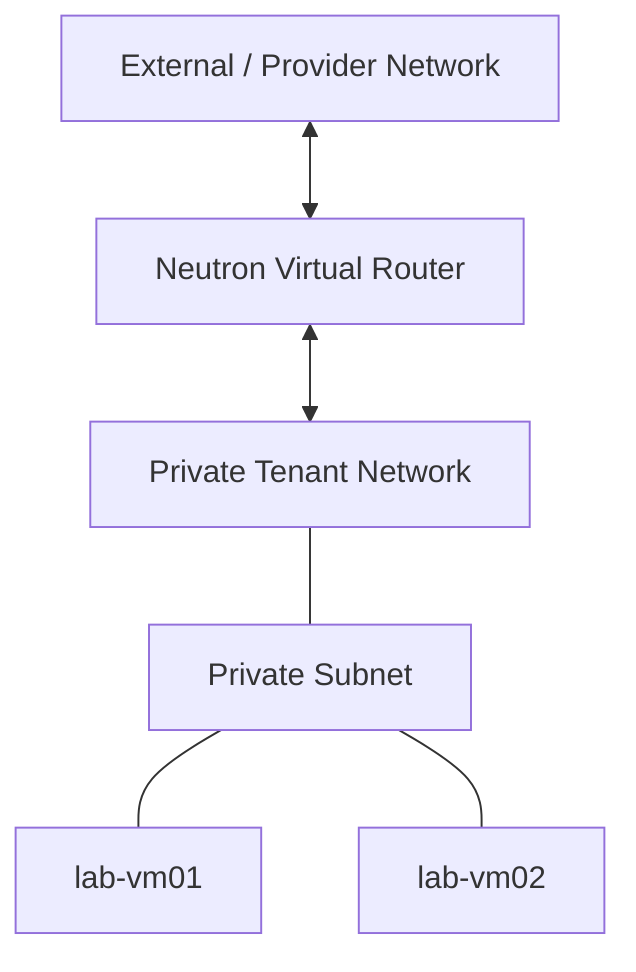

# OpenStack Neutron — Networking

## 1. Overview

Neutron is the OpenStack Networking service responsible for managing virtual networks, subnets, routers, ports, security groups, and floating IP connectivity.

It connects virtual machine workloads to private tenant networks and external infrastructure through configurable networking backends.

This document covers Neutron administration, virtual networking, routing, security, connectivity verification, and troubleshooting.

## 2. Network Architecture



The diagram represents logical network relationships. Actual packet forwarding depends on the Neutron backend, routing implementation, and physical network configuration.

## 3. Core Networking Components

| Component | Responsibility |
|---|---|
| Network | Provides Layer 2 connectivity |
| Subnet | Defines IP allocation, gateway, and DNS settings |
| Port | Connects an instance or network device to a virtual network |
| Router | Provides Layer 3 connectivity between networks |
| Security Group | Applies stateful traffic filtering |
| Floating IP | Maps an external address to an instance port |
| Provider Network | Connects virtual networks to external infrastructure |

## 4. Reference Network Configuration

The following example illustrates a project-isolated network with a virtual router and external connectivity.

| Resource | Example |
|---|---|
| Project | infrastructure-lab |
| Private Network | private-lab-net |
| Private Subnet | private-lab-subnet |
| Private CIDR | 198.51.100.0/24 |
| Gateway | 198.51.100.1 |
| Virtual Router | lab-router |
| External Network | public-net |
| Instance | lab-vm01 |
| Security Group | lab-ssh |

The example IP addresses belong to reserved documentation ranges. Actual infrastructure requires suitable non-overlapping addresses.

The external network `public-net` must be configured and accessible to the project.

## 5. Prerequisites

Network administration requires:

- An operational OpenStack Neutron service
- OpenStackClient and valid authentication
- Appropriate permissions for network resources
- Available networking backend infrastructure
- A configured external network for external routing

Verify access:

```bash
openstack token issue
openstack network list
openstack subnet list
openstack router list
```

## 6. Private Network Creation

Create a private network:

```bash
openstack network create private-lab-net
```

Verify:

```bash
openstack network show private-lab-net
```

A Neutron network provides virtual Layer 2 connectivity for attached ports.

## 7. Subnet Configuration

Create a subnet:

```bash
openstack subnet create \
  --network private-lab-net \
  --subnet-range 198.51.100.0/24 \
  --gateway 198.51.100.1 \
  --dns-nameserver 1.1.1.1 \
  private-lab-subnet
```

Verify:

```bash
openstack subnet show private-lab-subnet
```

The DNS resolver must be reachable from the network where the instance operates.

Use an internal resolver where external DNS access is unavailable.

## 8. Virtual Router Configuration

Create a router:

```bash
openstack router create lab-router
```

Attach the private subnet:

```bash
openstack router add subnet \
  lab-router private-lab-subnet
```

Set the external gateway:

```bash
openstack router set \
  --external-gateway public-net \
  lab-router
```

Verify:

```bash
openstack router show lab-router
openstack router list
```

The external gateway requires a suitable provider network and authorized project access.

## 9. Security Group Management

Create a dedicated security group:

```bash
openstack security group create \
  --description "Restricted SSH access" \
  lab-ssh
```

Allow SSH from the authorized management subnet:

```bash
openstack security group rule create \
  --protocol tcp \
  --dst-port 22 \
  --remote-ip 192.0.2.0/24 \
  lab-ssh
```

Allow ICMP from the same network:

```bash
openstack security group rule create \
  --protocol icmp \
  --remote-ip 192.0.2.0/24 \
  lab-ssh
```

Replace the documentation-only source network with an authorized management range.

Review the rules:

```bash
openstack security group rule list lab-ssh
```

Security groups are typically applied to instance network ports. Their exact behavior depends on the networking backend and cloud policies.

## 10. Floating IP Management

Floating IPs provide external address mapping for instances on private networks.

Allocate a floating IP:

```bash
openstack floating ip create public-net
```

List allocated addresses:

```bash
openstack floating ip list
```

Associate an allocated floating IP with an instance:

```bash
openstack server add floating ip \
  lab-vm01 FLOATING_IP_ADDRESS
```

Replace `FLOATING_IP_ADDRESS` with the address assigned by OpenStack.

Verify:

```bash
openstack server show lab-vm01
openstack floating ip list
```

Floating IP connectivity requires appropriate router configuration, security group permissions, and external network reachability.

## 11. Network Inspection

List networks:

```bash
openstack network list
```

Inspect subnets:

```bash
openstack subnet list
```

Inspect routers:

```bash
openstack router list
```

List ports attached to an instance:

```bash
openstack port list --server lab-vm01
```

Inspect security groups:

```bash
openstack security group list
openstack security group rule list lab-ssh
```

These commands provide visibility into virtual network resources and their configuration.

## 12. Network Connectivity Workflow

A typical inbound connection to an instance using a floating IP follows this conceptual path:

```text
Management Client
       |
External / Provider Network
       |
Floating IP Translation
       |
Neutron Router / Networking Backend
       |
Private Tenant Network
       |
Instance Network Port
       |
Virtual Machine
```

Actual packet forwarding varies according to the deployed network architecture.

Some environments use centralized routing, while others use distributed networking components.

## 13. Troubleshooting

### Instance Cannot Reach Its Gateway

Inspect:

- Guest network interface configuration
- Neutron port binding and status
- Subnet gateway
- Virtual networking backend
- Security group and host firewall policies

Commands:

```bash
openstack port list --server lab-vm01
openstack subnet show private-lab-subnet
openstack router show lab-router
```

Verify the guest operating system's interface configuration and routing table.

### Floating IP Is Unreachable

Check:

- Floating IP allocation and association
- Virtual router external gateway
- Provider network reachability
- Security group ingress rules
- Guest firewall configuration
- Underlying physical routing

Commands:

```bash
openstack floating ip list
openstack server show lab-vm01
openstack router show lab-router
```

### DNS Resolution Failure

Check:

- Subnet DNS settings
- Guest resolver configuration
- DNS server availability
- Routing to the DNS server
- Security group egress restrictions

Commands:

```bash
openstack subnet show private-lab-subnet
openstack port list --server lab-vm01
```

Network troubleshooting should account for the guest operating system, virtualization layer, Neutron configuration, and underlying physical network.

## 14. Neutron and Traditional Enterprise Networking

Neutron concepts can be compared with familiar enterprise switching and routing technologies.

| Traditional Networking | OpenStack Networking |
|---|---|
| Layer 2 segment or VLAN | Neutron network |
| IP subnet | Neutron subnet |
| Router or Layer 3 gateway | Neutron router |
| Switch port or virtual NIC attachment | Neutron port |
| Stateful firewall filtering | Security group |
| NAT and external address mapping | Floating IP |
| Physical uplink | Provider network connectivity |

These are conceptual comparisons, not exact technical equivalents.

Neutron introduces software-defined network management while still depending on the underlying physical infrastructure.

## 15. Operational Verification Checklist

### Network Resources

- [ ] Verify Neutron API access
- [ ] Inspect available networks and subnets
- [ ] Verify private network configuration
- [ ] Inspect IP allocation and gateway settings

### Routing

- [ ] Verify virtual router configuration
- [ ] Confirm subnet attachment
- [ ] Verify external gateway configuration
- [ ] Validate inter-network connectivity

### Security

- [ ] Review security group rules
- [ ] Restrict SSH to authorized sources
- [ ] Validate permitted ICMP traffic
- [ ] Verify guest firewall policies

### Connectivity

- [ ] Inspect instance network ports
- [ ] Verify VM-to-gateway connectivity
- [ ] Allocate and associate a floating IP
- [ ] Verify external routing
- [ ] Test DNS resolution

### Troubleshooting

- [ ] Investigate a port binding issue
- [ ] Investigate a security group connectivity failure
- [ ] Verify provider network connectivity
- [ ] Review relevant networking logs
- [ ] Document configuration and verification results

## 16. Related Documentation

- [OpenStack Architecture](architecture.md)
- [Nova Compute Management](nova-compute.md)
- [Keystone Identity Management](keystone-identity.md)
- [Operations and Troubleshooting](troubleshooting.md)

## 17. References

- [OpenStack Neutron Documentation](https://docs.openstack.org/neutron/latest/)
- [OpenStackClient Network Commands](https://docs.openstack.org/python-openstackclient/latest/cli/command-objects/network/v2/index.html)
- [OpenStack Documentation](https://docs.openstack.org/)
