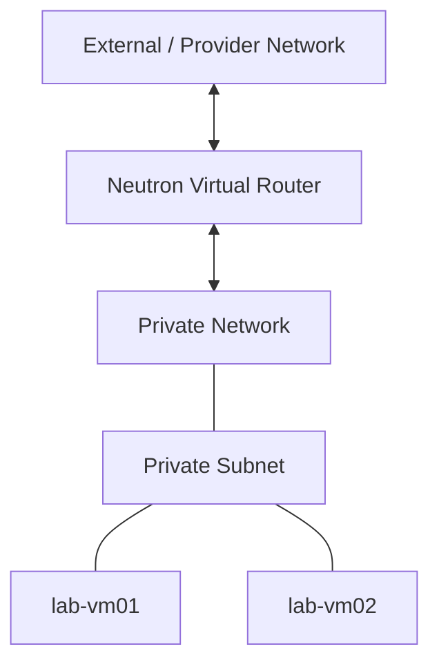

# OpenStack Neutron — Networking

## 1. Overview

Neutron is the OpenStack Networking service. It provides virtual networks, subnets, routers, ports, security groups, and floating IP connectivity.

This document presents a proposed private cloud networking scenario and OpenStack CLI examples.

**Status:** Documentation prepared. Lab validation pending.

## 2. Network Architecture



The diagram is conceptual. Actual network forwarding depends on the selected Neutron backend, routing implementation, and external connectivity configuration.

## 3. Key Components

| Component | Purpose |
|---|---|
| Network | Layer 2 connectivity for cloud resources |
| Subnet | IP addressing, gateway and DHCP settings |
| Port | Virtual network attachment point |
| Router | Layer 3 connectivity between networks |
| Security Group | Stateful traffic filtering for ports |
| Floating IP | External address mapped to an instance port |
| Provider Network | Connectivity to external infrastructure |

## 4. Proposed Lab Scenario

| Resource | Example |
|---|---|
| Project | infrastructure-lab |
| Private Network | private-lab-net |
| Private Subnet | private-lab-subnet |
| Private CIDR | 198.51.100.0/24 |
| Gateway | 198.51.100.1 |
| Virtual Router | lab-router |
| External Network | public-net |
| Instance | lab-vm01 |
| Security Group | lab-ssh |

The addresses above are documentation-only TEST-NET values. Replace them with suitable, non-overlapping private network addresses during implementation.

The lab assumes an external network named `public-net` has already been configured by a cloud administrator.

## 5. Prerequisites

- OpenStack deployment with Neutron operational
- OpenStackClient installed and authenticated
- Permission to manage network resources
- External network configured by the cloud administrator
- Nova instance available for later connectivity testing

Verify authentication and networking resources:

```bash
openstack token issue
openstack network list
openstack subnet list
openstack router list
```

## 6. Create a Private Network

```bash
openstack network create private-lab-net
```

Verify:

```bash
openstack network show private-lab-net
```

## 7. Create a Subnet

```bash
openstack subnet create \
  --network private-lab-net \
  --subnet-range 198.51.100.0/24 \
  --gateway 198.51.100.1 \
  --dns-nameserver 1.1.1.1 \
  private-lab-subnet
```

Verify:

```bash
openstack subnet show private-lab-subnet
```

The DNS server requires network connectivity to be usable. In a fully isolated environment, configure an accessible internal resolver instead.

## 8. Create a Virtual Router

```bash
openstack router create lab-router
```

Connect the private subnet:

```bash
openstack router add subnet \
  lab-router private-lab-subnet
```

Connect the router to a preconfigured external network:

```bash
openstack router set \
  --external-gateway public-net \
  lab-router
```

Verify:

```bash
openstack router show lab-router
openstack router list
```

The external gateway command requires a network configured for external routing and appropriate cloud permissions.

## 9. Security Groups

Create a security group if it does not already exist:

```bash
openstack security group create \
  --description "Restricted SSH access for lab instances" \
  lab-ssh
```

Allow inbound SSH from a designated management subnet:

```bash
openstack security group rule create \
  --protocol tcp \
  --dst-port 22 \
  --remote-ip 192.0.2.0/24 \
  lab-ssh
```

Allow ICMP echo requests from the same subnet:

```bash
openstack security group rule create \
  --protocol icmp \
  --remote-ip 192.0.2.0/24 \
  lab-ssh
```

The source range is a documentation-only placeholder. Replace it with the actual authorized management network.

Review the rules:

```bash
openstack security group rule list lab-ssh
```

Avoid opening administrative ports to unrestricted sources.

## 10. Floating IP Management

Floating IP addresses allow external connectivity to instances on private tenant networks when routing and security policies permit.

Allocate a floating IP from the external network:

```bash
openstack floating ip create public-net
```

List allocated addresses:

```bash
openstack floating ip list
```

Associate the allocated address with the instance:

```bash
openstack server add floating ip \
  lab-vm01 FLOATING_IP_ADDRESS
```

Replace `FLOATING_IP_ADDRESS` with the actual address returned by OpenStack.

Verify:

```bash
openstack server show lab-vm01
openstack floating ip list
```

The instance must have a suitable Neutron port connected through a router to the external network.

## 11. Network Inspection

List networks:

```bash
openstack network list
```

List subnets:

```bash
openstack subnet list
```

List routers:

```bash
openstack router list
```

List instance ports:

```bash
openstack port list --server lab-vm01
```

Inspect security groups:

```bash
openstack security group list
openstack security group rule list lab-ssh
```

## 12. Network Connectivity Workflow

A typical connection from an external management client to an instance follows this conceptual path:

```text
Management Client
       |
External / Provider Network
       |
Floating IP Translation
       |
Neutron Router / Networking Backend
       |
Private Tenant Network
       |
Instance Network Port
       |
Virtual Machine
```

The actual path depends on the networking backend, distributed routing configuration, and underlying physical network.

## 13. Troubleshooting

### Instance Cannot Reach Its Gateway

Check:

- Instance interface configuration
- Neutron port status
- Subnet gateway configuration
- Virtual networking backend health
- Security policies

Commands:

```bash
openstack port list --server lab-vm01
openstack subnet show private-lab-subnet
openstack router show lab-router
```

### Floating IP Is Not Reachable

Check:

- Floating IP association
- Router external gateway
- External/provider network reachability
- Security group ingress rules
- Guest firewall
- Physical routing and connectivity

Commands:

```bash
openstack floating ip list
openstack server show lab-vm01
openstack router show lab-router
```

### Instance Cannot Resolve DNS

Check:

- Subnet DNS configuration
- Guest resolver configuration
- DNS server reachability
- Security group and egress policy

Commands:

```bash
openstack subnet show private-lab-subnet
openstack port list --server lab-vm01
```

Network troubleshooting must consider both the virtual network and its underlying physical infrastructure.

## 14. Neutron and Traditional Networking

OpenStack networking introduces concepts familiar from enterprise switching and routing.

| Traditional Networking | OpenStack Networking |
|---|---|
| Layer 2 network / VLAN | Neutron network |
| IP subnet | Neutron subnet |
| Router / Layer 3 gateway | Neutron router |
| Switch port / virtual NIC attachment | Neutron port |
| Stateful firewall policy | Security group |
| NAT / external address mapping | Floating IP |
| Physical uplink and external routing | Provider network connectivity |

These mappings are conceptual comparisons rather than exact technical equivalences.

## 15. Lab Validation Checklist

- [ ] Verify Neutron services and networking backend
- [ ] Create a private network
- [ ] Create a subnet
- [ ] Verify IP allocation
- [ ] Create a virtual router
- [ ] Connect the subnet to the router
- [ ] Configure external gateway connectivity
- [ ] Create restricted security group rules
- [ ] Attach an instance to the private network
- [ ] Allocate and associate a floating IP
- [ ] Validate VM-to-gateway connectivity
- [ ] Validate external connectivity
- [ ] Troubleshoot an intentional connectivity failure
- [ ] Record sanitized CLI output and screenshots

## 16. Current Status

The networking configuration and commands in this document are proposed examples.

They have not yet been executed or validated in the public portfolio lab.

Implementation evidence will be added after testing.

## References

- [OpenStackClient Network Commands](https://docs.openstack.org/python-openstackclient/latest/cli/command-objects/network/v2/index.html)
- [OpenStack Neutron Documentation](https://docs.openstack.org/neutron/latest/)
