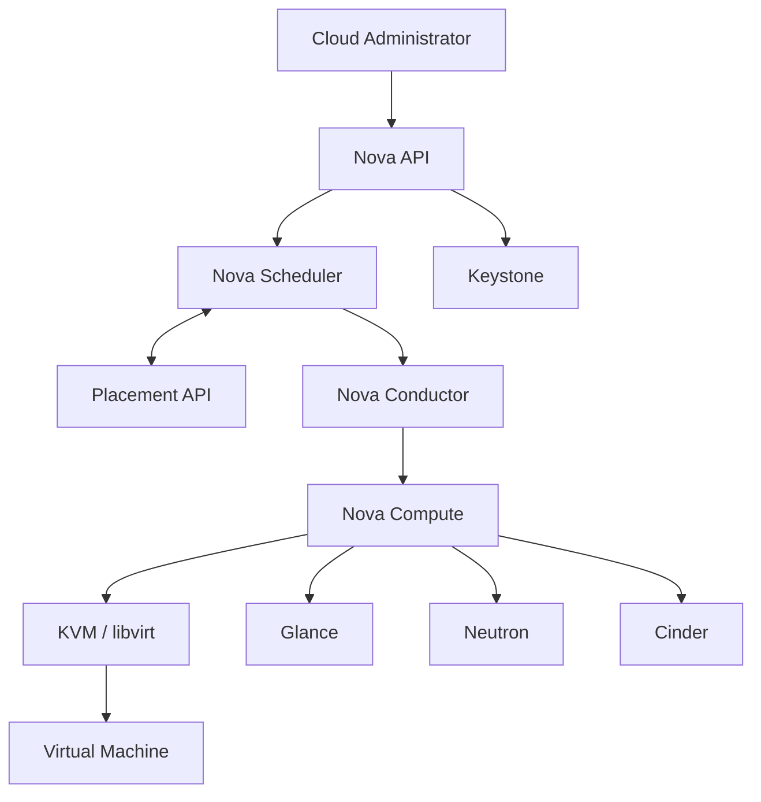

# OpenStack Nova — Compute Management

## 1. Overview

Nova is the OpenStack Compute service responsible for provisioning and managing virtual machine instances.

It coordinates compute scheduling, instance lifecycle operations, and integration with virtualization hosts, networking, images, and block storage.

This document covers Nova architecture, instance provisioning, lifecycle management, operational monitoring, and troubleshooting.

## 2. Nova Architecture



The diagram provides a simplified representation of Nova components and their relationships.

Actual internal communication depends on the OpenStack release and deployment configuration.

## 3. Core Components

| Component | Responsibility |
|---|---|
| Nova API | Processes compute API requests |
| Nova Scheduler | Selects suitable compute hosts |
| Placement | Maintains resource inventories and allocations |
| Nova Conductor | Coordinates compute workflows and database access |
| Nova Compute | Manages instances on compute hosts |
| KVM / libvirt | Provides virtualization capabilities |

Nova integrates with Keystone for authentication, Glance for images, Neutron for networking, and Cinder for persistent block storage.

## 4. Compute Administration Scenario

The following example demonstrates provisioning and managing a Linux instance within a dedicated OpenStack project.

| Resource | Example |
|---|---|
| Project | infrastructure-lab |
| Instance | lab-vm01 |
| Image | ubuntu-lab-image |
| Flavor | lab.small |
| Network | private-lab-net |
| Security Group | lab-ssh |
| Key Pair | lab-key |

The resource names are illustrative and must correspond to existing cloud resources when executing the commands.

## 5. Prerequisites

Instance provisioning requires:

- A working OpenStack Compute service
- Valid authentication credentials
- Available compute resources
- A compatible image
- An appropriate flavor
- A configured Neutron network
- A security group
- An SSH key pair, if required

Verify authentication:

```bash
openstack token issue
```

Inspect compute services:

```bash
openstack compute service list
```

List hypervisors:

```bash
openstack hypervisor list
```

Administrative permissions may be required for infrastructure-level inspection commands.

## 6. Image Management

List available images:

```bash
openstack image list
```

Inspect the selected image:

```bash
openstack image show ubuntu-lab-image
```

Image creation, upload, and management are covered in the Glance documentation.

## 7. Flavor Management

A flavor defines the virtual hardware resources allocated to an instance.

Typical properties include:

- Virtual CPUs
- Memory
- Root disk size
- Additional resource specifications

List flavors:

```bash
openstack flavor list
```

Create a sample flavor:

```bash
openstack flavor create \
  --vcpus 1 \
  --ram 2048 \
  --disk 10 \
  lab.small
```

Verify:

```bash
openstack flavor show lab.small
```

Flavor creation is usually restricted to authorized administrators.

The image, compute host, and selected flavor must be compatible.

## 8. SSH Key Pair Management

Import an existing public SSH key:

```bash
openstack keypair create \
  --public-key ~/.ssh/id_ed25519.pub \
  lab-key
```

List key pairs:

```bash
openstack keypair list
```

Only public keys should be uploaded to OpenStack.

Private SSH keys must remain protected and must not be committed to source control.

## 9. Security Group Configuration

Create a dedicated security group:

```bash
openstack security group create \
  --description "Restricted SSH access" \
  lab-ssh
```

Allow SSH connectivity from an authorized management network:

```bash
openstack security group rule create \
  --protocol tcp \
  --dst-port 22 \
  --remote-ip 192.0.2.0/24 \
  lab-ssh
```

The source address is a documentation-only example and must be replaced with the correct management subnet.

Verify the rules:

```bash
openstack security group rule list lab-ssh
```

## 10. Instance Provisioning

Verify the target network:

```bash
openstack network show private-lab-net
```

Create an instance:

```bash
openstack server create \
  --image ubuntu-lab-image \
  --flavor lab.small \
  --network private-lab-net \
  --security-group lab-ssh \
  --key-name lab-key \
  lab-vm01
```

Inspect the instance:

```bash
openstack server show lab-vm01
```

List instances:

```bash
openstack server list
```

After the instance reaches `ACTIVE`, verify operating system startup and network connectivity.

## 11. Instance Lifecycle Management

### Stop

```bash
openstack server stop lab-vm01
```

### Start

```bash
openstack server start lab-vm01
```

### Soft Reboot

```bash
openstack server reboot lab-vm01
```

### Hard Reboot

```bash
openstack server reboot --hard lab-vm01
```

Hard reboots can interrupt workloads and should be performed only when appropriate.

### Delete

```bash
openstack server delete lab-vm01
```

Instance deletion is destructive. Data on ephemeral storage may be lost.

## 12. Monitoring and Inspection

List detailed instance information:

```bash
openstack server list --long
```

Inspect an instance:

```bash
openstack server show lab-vm01
```

View console output:

```bash
openstack console log show lab-vm01
```

List instance events:

```bash
openstack server event list lab-vm01
```

Inspect compute services:

```bash
openstack compute service list
```

Inspect hypervisors:

```bash
openstack hypervisor list
```

These commands provide operational information about instances and compute infrastructure.

For infrastructure monitoring, Nova can be complemented by external tools such as Zabbix or Netdata.

## 13. Troubleshooting

### Instance Remains in BUILD

Possible causes include:

- Insufficient compute resources
- Scheduling constraints
- Unavailable compute services
- Image provisioning issues
- Network allocation failures
- Hypervisor problems

Investigation commands:

```bash
openstack server show lab-vm01
openstack server event list lab-vm01
openstack compute service list
openstack hypervisor list
```

Review Nova service logs where administrative access is available.

### Instance Enters ERROR State

Inspect the instance:

```bash
openstack server show lab-vm01
```

Inspect events:

```bash
openstack server event list lab-vm01
```

Check available fault details:

```bash
openstack server show lab-vm01 -c fault
```

Fault information and event details may be restricted by cloud policy.

Additional investigation may require access to Nova Compute and hypervisor logs.

### Instance Has No Network Connectivity

Inspect attached network ports:

```bash
openstack port list --server lab-vm01
```

Check security group configuration:

```bash
openstack security group rule list lab-ssh
```

Inspect networks:

```bash
openstack network list
openstack subnet list
openstack router list
```

Verify:

- Guest operating system network configuration
- Neutron port status
- Security group rules
- Subnet and gateway settings
- Virtual router connectivity
- External network routing

Detailed networking procedures are covered in the Neutron documentation.

### Instance Cannot Boot from an Image

Verify the image:

```bash
openstack image show ubuntu-lab-image
```

Check the flavor:

```bash
openstack flavor show lab.small
```

Review the instance:

```bash
openstack server show lab-vm01
```

Confirm image format, operating system architecture, boot requirements, and hypervisor compatibility.

## 14. Operational Verification Checklist

### Compute Infrastructure

- [ ] Verify Nova API availability
- [ ] Inspect compute service status
- [ ] Inspect hypervisor resources
- [ ] Check available compute capacity

### Instance Provisioning

- [ ] Confirm image availability
- [ ] Verify flavor configuration
- [ ] Verify target network
- [ ] Configure an SSH key pair
- [ ] Review security group rules
- [ ] Provision a virtual machine
- [ ] Verify ACTIVE state
- [ ] Confirm guest operating system startup

### Lifecycle Operations

- [ ] Test instance stop and start
- [ ] Test instance reboot
- [ ] Inspect console output
- [ ] Review instance events

### Troubleshooting

- [ ] Investigate a provisioning failure
- [ ] Inspect scheduler and resource constraints
- [ ] Review networking dependencies
- [ ] Review relevant service logs
- [ ] Document corrective actions and verification results

## 15. Related Documentation

- [OpenStack Architecture](architecture.md)
- [Keystone Identity Management](keystone-identity.md)
- [Neutron Networking](neutron-networking.md)
- [Glance Image Management](glance-images.md)
- [Cinder Block Storage](cinder-storage.md)
- [Operations and Troubleshooting](troubleshooting.md)

## 16. References

- [OpenStack Nova Documentation](https://docs.openstack.org/nova/latest/)
- [OpenStackClient Compute Commands](https://docs.openstack.org/python-openstackclient/latest/cli/command-objects/compute/v2/index.html)
- [OpenStack Documentation](https://docs.openstack.org/)
