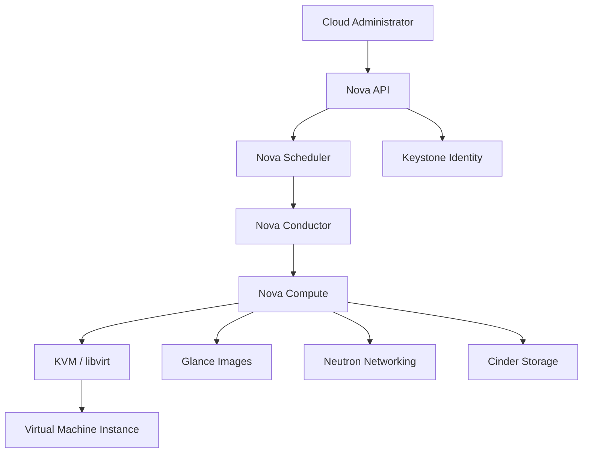

# OpenStack Nova — Compute Management

## 1. Overview

Nova is the OpenStack Compute service responsible for managing the lifecycle of virtual machine instances.

It coordinates compute resources, schedules instances on available hypervisors, and works with other OpenStack services to provision virtual infrastructure.

This document describes Nova architecture, instance provisioning, lifecycle operations, and troubleshooting in a proposed private cloud lab.

**Status:** Documentation and CLI examples prepared. Lab validation pending.

## 2. Nova Architecture



This diagram represents a simplified Nova workflow. Actual service communication and scheduling depend on the OpenStack release and deployment architecture.

## 3. Core Components

| Component | Responsibility |
|---|---|
| Nova API | Handles compute API requests |
| Nova Scheduler | Selects a suitable compute host |
| Nova Conductor | Coordinates database-related operations and compute workflows |
| Nova Compute | Manages instance lifecycle on compute hosts |
| Placement | Tracks resource inventories and allocations |
| KVM / libvirt | Provides virtualization capabilities |

Nova integrates with Keystone, Glance, Neutron, and optionally Cinder during instance provisioning.

## 4. Proposed Lab Scenario

The lab will provision a small Linux virtual machine in the `infrastructure-lab` project.

Example resources:

| Resource | Example |
|---|---|
| Project | infrastructure-lab |
| Instance | lab-vm01 |
| Image | ubuntu-lab-image |
| Flavor | lab.small |
| Network | private-lab-net |
| Security Group | lab-ssh |
| Key Pair | lab-key |

All names are illustrative. The required resources must exist before instance creation.

## 5. Prerequisites

A working lab deployment must provide:

- OpenStack authentication
- A configured compute service
- Available compute capacity
- A usable image in Glance
- A flavor
- A Neutron network
- A suitable security group
- An SSH key pair, if key-based access is required

Verify authentication:

```bash
openstack token issue
```

Verify available compute services:

```bash
openstack compute service list
```

List hypervisors:

```bash
openstack hypervisor list
```

Some commands require elevated permissions depending on cloud policy.

## 6. Image Management

List available images:

```bash
openstack image list
```

Inspect an image:

```bash
openstack image show ubuntu-lab-image
```

Image upload and management are documented separately in the Glance module.

## 7. Flavor Management

A flavor defines the virtual hardware profile of an instance.

Typical attributes include:

- Virtual CPUs
- RAM
- Root disk size
- Additional resource properties

List available flavors:

```bash
openstack flavor list
```

Example flavor creation (requires appropriate permissions):

```bash
openstack flavor create \
  --vcpus 1 \
  --ram 2048 \
  --disk 10 \
  lab.small
```

Check the flavor:

```bash
openstack flavor show lab.small
```

The example requires an image and compute environment compatible with the selected disk and memory allocation.

## 8. SSH Key Pair

Import an existing public SSH key:

```bash
openstack keypair create \
  --public-key ~/.ssh/id_ed25519.pub \
  lab-key
```

Verify:

```bash
openstack keypair list
```

Only public keys should be imported or shared.

Never commit private SSH keys to the repository.

## 9. Security Group

Create an example security group:

```bash
openstack security group create \
  --description "SSH access for the private cloud lab" \
  lab-ssh
```

Allow SSH access from a restricted management subnet.

The following IP range is documentation-only:

```bash
openstack security group rule create \
  --protocol tcp \
  --dst-port 22 \
  --remote-ip 192.0.2.0/24 \
  lab-ssh
```

Replace the example range with the actual authorized management subnet during lab deployment.

## 10. Instance Provisioning

Before creating an instance, confirm that `private-lab-net` exists:

```bash
openstack network show private-lab-net
```

Create a VM:

```bash
openstack server create \
  --image ubuntu-lab-image \
  --flavor lab.small \
  --network private-lab-net \
  --security-group lab-ssh \
  --key-name lab-key \
  lab-vm01
```

Check provisioning status:

```bash
openstack server show lab-vm01
```

List instances:

```bash
openstack server list
```

Wait for the instance to reach `ACTIVE` before performing connectivity checks.

## 11. Instance Lifecycle Management

### Stop an Instance

```bash
openstack server stop lab-vm01
```

### Start an Instance

```bash
openstack server start lab-vm01
```

### Reboot an Instance

```bash
openstack server reboot lab-vm01
```

### Hard Reboot

```bash
openstack server reboot --hard lab-vm01
```

A hard reboot should be used cautiously because it can interrupt workloads.

### Delete an Instance

```bash
openstack server delete lab-vm01
```

Deletion is destructive and may remove data stored on an ephemeral root disk.

## 12. Monitoring and Inspection

List instances:

```bash
openstack server list --long
```

Inspect instance details:

```bash
openstack server show lab-vm01
```

View console logs:

```bash
openstack console log show lab-vm01
```

Inspect compute services:

```bash
openstack compute service list
```

Inspect hypervisor resources:

```bash
openstack hypervisor list
```

Operational monitoring can also incorporate external infrastructure monitoring systems.

## 13. Troubleshooting

### Instance Remains in BUILD

Check:

- Available compute resources
- Nova Scheduler and Compute services
- Image availability
- Network allocation
- Compute host connectivity
- Relevant Nova service logs

Useful commands:

```bash
openstack server show lab-vm01
openstack compute service list
openstack hypervisor list
```

### Instance Enters ERROR State

Inspect the instance:

```bash
openstack server show lab-vm01
```

Check available fault information:

```bash
openstack server show lab-vm01 -c fault
```

Fault details may be restricted by cloud policy.

Also inspect Nova and hypervisor logs where administrative access is available.

### Instance Has No Network Connectivity

Verify:

- Assigned Neutron ports
- Network and subnet configuration
- Security group rules
- Router and external network configuration
- Guest operating system networking

Commands:

```bash
openstack port list --server lab-vm01
openstack security group list
openstack network list
```

Detailed connectivity troubleshooting will be documented in the Neutron module.

## 14. Lab Validation Checklist

- [ ] Verify Nova services
- [ ] Verify compute host availability
- [ ] Confirm image availability
- [ ] Create a lab flavor
- [ ] Import a public SSH key
- [ ] Create a security group
- [ ] Launch lab-vm01
- [ ] Verify ACTIVE state
- [ ] Inspect instance information
- [ ] Test stop, start, and reboot operations
- [ ] Validate network connectivity
- [ ] Capture sanitized logs and screenshots

## 15. Current Status

This document provides a proposed Nova Compute administration scenario and example OpenStack CLI commands.

The examples have not yet been executed or validated in the public portfolio lab.

Execution evidence and troubleshooting outcomes will be added after lab testing.
