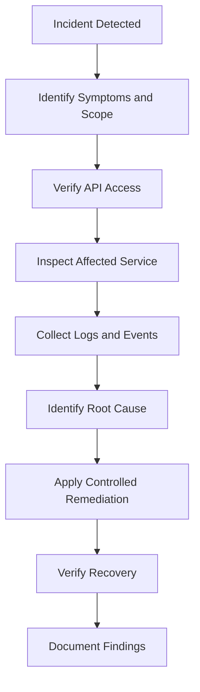

# OpenStack Operations — Troubleshooting & Health Checks

## 1. Overview

This document provides an operational troubleshooting framework for OpenStack private cloud infrastructure.

It covers identity, compute, networking, image management, block storage, and infrastructure-level diagnostics.

The objective is to identify service failures, collect diagnostic evidence, isolate root causes, apply controlled remediation, and verify service recovery.

## 2. Troubleshooting Methodology

A structured approach helps reduce incident resolution time and prevents unnecessary configuration changes.



Investigation depth should reflect the incident scope and available administrative permissions.

## 3. Initial Health Checks

### Keystone Authentication

```bash
openstack token issue
```

Verify authentication endpoints, credentials, project scope, and Keystone availability when authentication fails.

### Service Catalog and Endpoints

```bash
openstack service list
openstack endpoint list
```

These commands verify service registration and endpoint configuration. Successful responses do not guarantee complete service health.

### Nova Compute

```bash
openstack compute service list
openstack hypervisor list
openstack server list --long
```

### Neutron Networking

```bash
openstack network list
openstack subnet list
openstack router list
openstack port list
```

For Neutron deployments using traditional agents:

```bash
openstack network agent list
```

Agent checks may not apply to all networking backends, including certain OVN deployments.

### Glance Image Service

```bash
openstack image list
```

### Cinder Block Storage

```bash
openstack volume list
openstack volume service list
```

Administrative permissions may be required for infrastructure-level commands.

## 4. Service Health Matrix

| Service | Typical Symptom | Initial Investigation |
|---|---|---|
| Keystone | Authentication failure | Token request and identity endpoint |
| Nova | VM stuck in BUILD | Instance details, events, compute services |
| Neutron | VM connectivity failure | Ports, routers, subnets, security groups |
| Glance | Image upload failure | Image status, format, backend |
| Cinder | Volume creation or attachment failure | Volume status, storage services |
| Horizon | Dashboard unavailable | Web endpoint, application and proxy logs |

## 5. Scenario A — Authentication Failure

**Symptom:** OpenStack CLI authentication fails.

### Investigation

1. Verify DNS resolution and connectivity to the identity endpoint.
2. Confirm the authentication method.
3. Inspect username, domain, project, and scope.
4. Review Keystone service availability.
5. Examine identity service logs.
6. Verify role assignments when authentication succeeds but access is restricted.

Commands:

```bash
openstack token issue
openstack endpoint list --service identity
```

Additional diagnostics:

```bash
openstack --debug token issue
```

Debug output can contain sensitive details. Never publish raw credentials or tokens.

### Recovery Verification

Confirm authentication succeeds using the expected user, domain, and project scope.

## 6. Scenario B — Instance Stuck in BUILD

**Symptom:** A Nova instance does not reach ACTIVE.

### Investigation

```bash
openstack server show lab-vm01
openstack compute service list
openstack hypervisor list
```

Inspect instance events:

```bash
openstack server event list lab-vm01
```

Inspect available console output:

```bash
openstack console log show --lines 50 lab-vm01
```

Review:

- Compute host availability
- Placement resource allocations
- Scheduling constraints
- Image compatibility
- Neutron port allocation
- Hypervisor and libvirt status
- Nova service logs

### Recovery Verification

Confirm that the instance reaches ACTIVE, boots correctly, and has the expected network connectivity.

## 7. Scenario C — Instance in ERROR State

Inspect instance details:

```bash
openstack server show lab-vm01
```

Inspect events:

```bash
openstack server event list lab-vm01
```

Review available fault information:

```bash
openstack server show lab-vm01 -c fault
```

Possible causes include:

- Insufficient compute resources
- Scheduling failures
- Image incompatibility
- Network allocation failures
- Hypervisor errors
- Storage attachment problems

Preserve diagnostic information before deleting or rebuilding an instance.

## 8. Scenario D — Virtual Machine Connectivity Failure

**Symptom:** A virtual machine cannot reach its gateway, another VM, or an external destination.

### Investigation

```bash
openstack port list --server lab-vm01
openstack network list
openstack subnet list
openstack router show lab-router
openstack floating ip list
```

Inspect security group rules:

```bash
openstack security group rule list lab-ssh
```

Check:

1. Guest operating system IP configuration
2. Virtual NIC and Neutron port status
3. Subnet gateway
4. Security group rules
5. Virtual router configuration
6. Provider network connectivity
7. Physical network routing and switching

### Network Troubleshooting Layers

```text
Application Connectivity
         |
Guest Operating System
         |
Virtual Network Interface
         |
Neutron Port / Security Group
         |
Tenant Network / Virtual Router
         |
Provider Network
         |
Physical Network
```

The investigation should distinguish guest configuration problems from virtual network and physical infrastructure failures.

## 9. Scenario E — Glance Image Failure

**Symptom:** A virtual machine image cannot be uploaded, activated, or used for provisioning.

### Investigation

```bash
openstack image list
openstack image show ubuntu-lab-image
```

Review:

- Image status
- Disk format
- Image integrity
- Checksum
- Storage backend availability
- Image quotas
- Hypervisor compatibility
- Glance API and backend logs

### Recovery Verification

Verify image status and confirm that a compatible instance can boot from the image.

## 10. Scenario F — Cinder Volume Attachment Failure

**Symptom:** A data volume cannot be attached to a virtual machine.

### Investigation

```bash
openstack volume show lab-data-volume
openstack server show lab-vm01
openstack server volume list lab-vm01
```

Inspect storage services where authorized:

```bash
openstack volume service list
```

Review:

- Volume status
- Instance status
- Storage backend availability
- Compute-to-storage connectivity
- Volume attachment limits
- Nova and Cinder logs

### Recovery Verification

Verify that the volume reaches the expected attached state and that the guest operating system detects the block device.

Avoid force-detaching volumes without considering filesystem and data integrity risks.

## 11. Host-Level Troubleshooting

Infrastructure-level investigation may require access to OpenStack controller, compute, or storage nodes.

For a systemd-managed Nova Compute service:

```bash
sudo systemctl status nova-compute
sudo journalctl -u nova-compute -n 100 --no-pager
```

Service names and log locations depend on the deployment method.

Container-based OpenStack deployments require appropriate container runtime inspection.

Always identify the deployment architecture before selecting host-level diagnostic commands.

## 12. Common Root Cause Categories

| Category | Examples |
|---|---|
| Authentication | Invalid credentials, incorrect project scope |
| Authorization | Missing role assignment, restrictive policy |
| Compute | Resource shortage, scheduling failure |
| Networking | Port binding, routing, security group rules |
| Storage | Backend unavailable, capacity shortage |
| Images | Unsupported format, corrupted image |
| Infrastructure | DNS, time synchronization, host connectivity |
| Configuration | Incorrect API endpoints, service settings |

## 13. Incident Documentation Template

### Incident Summary

- Incident ID:
- Date:
- Affected service:
- Severity:
- Reported symptom:
- Impacted resources:

### Investigation

- Relevant alerts:
- Commands executed:
- Observed results:
- Relevant logs:
- Root cause:

### Resolution

- Corrective action:
- Change authorization:
- Verification steps:
- Final service status:

### Follow-Up

- Preventive actions:
- Monitoring improvements:
- Documentation updates:

Sanitize logs and screenshots before sharing them outside the authorized environment.

## 14. Monitoring and Observability

OpenStack infrastructure monitoring can cover:

- API endpoint availability
- Keystone authentication checks
- Compute host status
- Instance state changes
- Networking component availability
- Cinder service availability
- Host CPU and memory usage
- Storage capacity and performance
- API response times
- Service errors and logs

Zabbix and Netdata can complement OpenStack-native operational checks with infrastructure metrics, availability monitoring, dashboards, and alerts.

Cloud-specific monitoring should combine API-level checks with underlying infrastructure metrics.

## 15. Operational Verification Checklist

### Identity

- [ ] Verify Keystone authentication
- [ ] Verify identity endpoints
- [ ] Review user role assignments

### Compute

- [ ] Verify Nova services
- [ ] Inspect hypervisors and compute capacity
- [ ] Review VM provisioning events
- [ ] Investigate instance ERROR states

### Networking

- [ ] Inspect Neutron ports and networks
- [ ] Verify virtual router connectivity
- [ ] Review security group policies
- [ ] Verify floating IP routing
- [ ] Investigate connectivity failures

### Storage and Images

- [ ] Inspect Glance images
- [ ] Verify image availability
- [ ] Inspect Cinder volumes
- [ ] Review volume attachment status
- [ ] Investigate storage backend errors

### Incident Response

- [ ] Collect service logs
- [ ] Identify root cause
- [ ] Apply controlled remediation
- [ ] Verify service recovery
- [ ] Document findings and preventive actions

## 16. Related Documentation

- [OpenStack Architecture](architecture.md)
- [Keystone Identity Management](keystone-identity.md)
- [Nova Compute Management](nova-compute.md)
- [Neutron Networking](neutron-networking.md)
- [Glance Image Management](glance-images.md)
- [Cinder Block Storage](cinder-storage.md)

## 17. References

- [OpenStack Operations Guide](https://docs.openstack.org/operations-guide/)
- [OpenStackClient Documentation](https://docs.openstack.org/python-openstackclient/latest/)
- [Nova Documentation](https://docs.openstack.org/nova/latest/)
- [Neutron Documentation](https://docs.openstack.org/neutron/latest/)
- [Cinder Documentation](https://docs.openstack.org/cinder/latest/)
