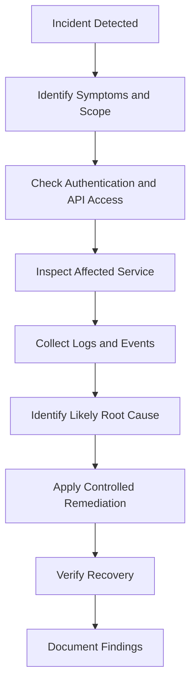

# OpenStack Operations — Troubleshooting & Health Checks

## 1. Overview

This document provides a structured troubleshooting approach for a proposed OpenStack private cloud lab.

It focuses on identity, compute, networking, image management, and block storage.

The objective is to identify the affected service, gather evidence, isolate the root cause, and verify recovery.

**Status:** Operational procedures documented. Lab validation pending.

## 2. Troubleshooting Methodology

A consistent troubleshooting workflow helps avoid unnecessary changes.



The checks should be adapted to the incident. Not every issue requires administrative access to every service.

## 3. Initial Health Checks

### Authentication

```bash
openstack token issue
```

If authentication fails, check the identity endpoint, credentials, project scope, and Keystone availability.

### Service Catalog and Endpoints

```bash
openstack service list
openstack endpoint list
```

These commands inspect registered services and API endpoints. They do not prove that every service is healthy.

### Compute

```bash
openstack compute service list
openstack hypervisor list
openstack server list --long
```

### Networking

```bash
openstack network list
openstack subnet list
openstack router list
openstack port list
```

For deployments using Neutron agents:

```bash
openstack network agent list
```

Agent-based checks may not apply to every networking backend, including some OVN deployments.

### Image Service

```bash
openstack image list
```

### Block Storage

```bash
openstack volume list
openstack volume service list
```

Some commands require administrator permissions.

## 4. Service Health Matrix

| Service | Example Symptom | Initial Check |
|---|---|---|
| Keystone | Authentication fails | `openstack token issue` |
| Nova | Instance remains in BUILD | `openstack server show` |
| Neutron | Instance has no connectivity | `openstack port list` |
| Glance | Image upload fails | `openstack image list` |
| Cinder | Volume remains in creating | `openstack volume show` |
| Horizon | Dashboard unavailable | Web endpoint and service logs |

These checks are starting points, not definitive health assessments.

## 5. Scenario A — Authentication Failure

**Symptom:** OpenStack CLI cannot authenticate.

### Investigation

1. Confirm that the identity endpoint is reachable.
2. Verify the selected authentication method.
3. Check username, domain, project, and scope.
4. Review Keystone API and supporting service logs.
5. Confirm that the user's role assignments are appropriate.

Commands:

```bash
openstack token issue
openstack --debug token issue
```

**Security note:** Debug output may contain sensitive request details. Redact credentials, tokens, and internal addresses before sharing logs.

### Recovery Validation

Confirm that authentication succeeds using the intended user and project.

Do not reset user passwords or modify policies without confirming the cause and obtaining authorization.

## 6. Scenario B — Instance Stuck in BUILD

**Symptom:** A Nova instance does not reach ACTIVE.

### Investigation

```bash
openstack server show lab-vm01
openstack compute service list
openstack hypervisor list
```

Inspect recent instance events:

```bash
openstack server event list lab-vm01
```

Inspect console output:

```bash
openstack console log show --lines 50 lab-vm01
```

Check:

- Available compute capacity
- Nova service availability
- Placement allocations and scheduling constraints
- Image availability and compatibility
- Neutron port allocation
- Hypervisor and libvirt state
- Nova service logs

### Recovery Validation

Verify that the instance reaches ACTIVE and that its operating system boots successfully.

An ACTIVE status alone does not guarantee application or network health.

## 7. Scenario C — Instance Enters ERROR State

Inspect the instance:

```bash
openstack server show lab-vm01
```

Check operation events:

```bash
openstack server event list lab-vm01
```

Check relevant Nova and compute host logs.

Possible causes include:

- Insufficient resources
- Scheduling failure
- Image incompatibility
- Networking allocation failure
- Hypervisor errors
- Storage attachment issues

Avoid immediately deleting the instance. Preserve relevant error information for diagnosis.

## 8. Scenario D — VM Network Connectivity Failure

**Symptom:** An instance cannot communicate with its gateway or an external destination.

### Investigation

```bash
openstack port list --server lab-vm01
openstack network list
openstack subnet list
openstack router show lab-router
openstack floating ip list
```

Inspect security group rules:

```bash
openstack security group rule list lab-ssh
```

Check:

1. Guest network interface and IP configuration
2. Neutron port binding and status
3. Subnet gateway settings
4. Security group ingress and egress policies
5. Virtual routing configuration
6. External/provider network connectivity
7. Underlying host networking

### Network Troubleshooting Layers

```text
Application Connectivity
         |
Guest Operating System
         |
Virtual Network Interface
         |
Neutron Port / Security Group
         |
Tenant Network / Virtual Router
         |
Provider Network
         |
Physical Network
```

Troubleshooting must distinguish guest-level problems from virtual network and physical infrastructure failures.

## 9. Scenario E — Image Provisioning Failure

**Symptom:** A Glance image cannot be uploaded or used.

### Investigation

```bash
openstack image list
openstack image show ubuntu-lab-image
```

Check:

- Image status
- Disk format
- Checksum and file integrity
- Storage backend capacity
- Image quotas
- Hypervisor compatibility
- Glance API and backend logs

### Recovery Validation

Confirm the image is active and successfully boots a new test instance.

Do not repeatedly upload or replace images without identifying the underlying failure.

## 10. Scenario F — Cinder Volume Attachment Failure

**Symptom:** A volume cannot be attached to an instance.

### Investigation

```bash
openstack volume show lab-data-volume
openstack server show lab-vm01
openstack server volume list lab-vm01
```

For authorized administrators:

```bash
openstack volume service list
```

Check:

- Volume status
- Instance status
- Storage service availability
- Backend connectivity
- Compute-to-storage connectivity
- Volume attachment limits
- Nova and Cinder logs

### Recovery Validation

Confirm that the volume reaches the expected attached state and is visible inside the guest.

Avoid force-detaching or resetting volume state without evaluating data integrity risks.

## 11. Host-Level Troubleshooting

When authorized access to OpenStack nodes is available, inspect the affected service using the deployment's service manager.

Example for a systemd-managed Nova Compute service:

```bash
sudo systemctl status nova-compute
sudo journalctl -u nova-compute -n 100 --no-pager
```

Service names and log locations vary by deployment method.

Container-based installations may require inspection through the selected container runtime instead of systemd units.

Never assume that a service is installed directly on the host.

## 12. Common Root Cause Categories

| Category | Examples |
|---|---|
| Authentication | Invalid credentials, wrong project scope |
| Authorization | Missing role assignment, restrictive policy |
| Compute | Resource shortage, scheduler failure |
| Networking | Incorrect routing, port binding, security rules |
| Storage | Backend unavailable, quota exceeded |
| Images | Corrupted image, unsupported format |
| Infrastructure | DNS, time synchronization, host connectivity |
| Configuration | Incorrect endpoint, service configuration |

## 13. Incident Documentation Template

Each lab incident should include:

### Incident Summary

- Incident ID:
- Date:
- Affected service:
- Severity:
- Reported symptom:

### Investigation

- Relevant alerts:
- Commands executed:
- Observed results:
- Relevant logs:
- Root cause:

### Resolution

- Corrective action:
- Change authorization:
- Verification steps:
- Final service status:

### Follow-Up

- Preventive action:
- Monitoring improvement:
- Documentation update:

Use sanitized screenshots and logs only.

## 14. Monitoring Opportunities

A future monitoring deployment could track:

- OpenStack API endpoint availability
- Authentication test results
- Compute host availability
- Instance state changes
- Network agent health, where applicable
- Volume service availability
- Host CPU, memory, and storage capacity
- Service error rates and response times

Zabbix or Netdata could provide infrastructure-level monitoring, while OpenStack API checks provide cloud-specific operational visibility.

No monitoring integration has yet been deployed as part of this public lab.

## 15. Lab Validation Checklist

- [ ] Validate Keystone authentication
- [ ] Verify compute services and hypervisors
- [ ] Create an intentional VM provisioning failure
- [ ] Capture and interpret Nova events
- [ ] Investigate a security group connectivity issue
- [ ] Validate floating IP routing
- [ ] Investigate an image-related failure
- [ ] Investigate a Cinder volume attachment failure
- [ ] Inspect service logs
- [ ] Verify recovery after each test
- [ ] Document sanitized before-and-after evidence

## 16. Current Status

All incident scenarios in this document are proposed exercises.

They have not been executed or validated in the public portfolio lab.

Actual incident findings, execution evidence, and operational improvements will be documented after testing.

## References

- [OpenStack Operations Guide](https://docs.openstack.org/operations-guide/)
- [OpenStackClient Documentation](https://docs.openstack.org/python-openstackclient/latest/)
- [Nova Documentation](https://docs.openstack.org/nova/latest/)
- [Neutron Documentation](https://docs.openstack.org/neutron/latest/)
- [Cinder Documentation](https://docs.openstack.org/cinder/latest/)
